# LitSSH MCP

[](https://opensource.org/licenses/MIT)
[](https://dotnet.microsoft.com/)
[](https://windows.com/)
[](https://modelcontextprotocol.io/)
[](https://opencode.ai/)

> **让 AI 安全地运维你的服务器。** Windows 下的 SSH / 数据库运维 MCP 服务器与 WPF 桌面管理端：统一 SSH、MySQL / PostgreSQL / Redis、资产拓扑、远程桌面、Jenkins、Kubernetes 与 AI 运维助手。

<p align="center">
  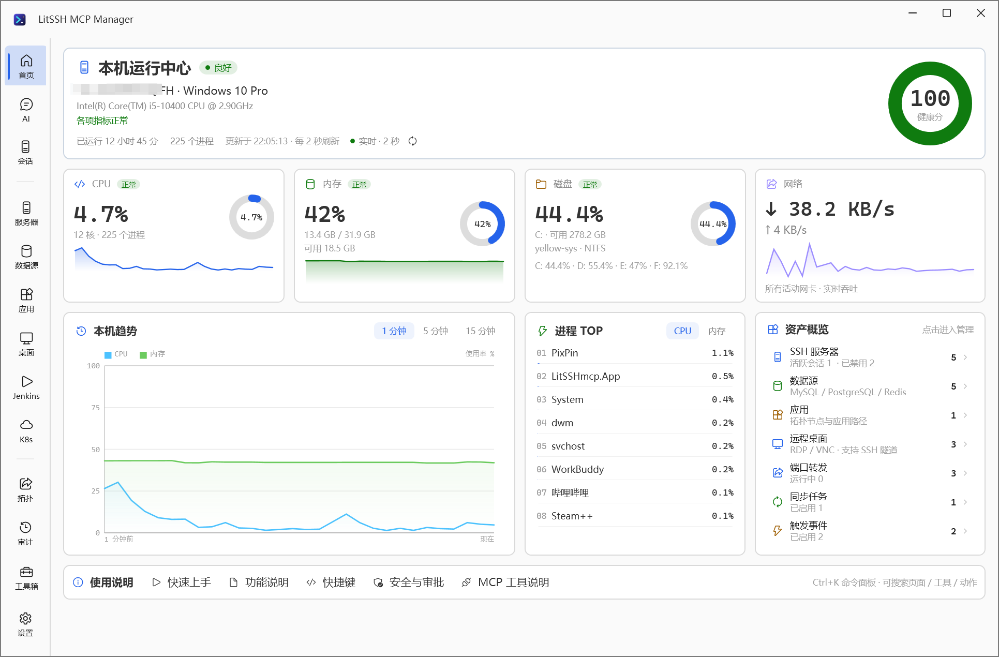
</p>

<p align="center">
</p>

> 🤖 本项目使用 [Opencode](https://opencode.ai/) AI 助手开发。

## 为什么选择 LitSSH MCP

- 🔒 **安全默认**：命令 / SQL 过滤、敏感操作审批、路径白名单、TOFU 主机密钥、按目标限流、HMAC-SHA256 哈希链审计。
- 🔑 **凭据隔离**：SSH / 数据库密码仅在本机 DPAPI 加密保存，工具入参与出参不包含密码。
- 🧭 **全链路排障**：应用 → 服务器 → 数据库 → Redis 的资产拓扑、快照、体检与影响面分析。
- 🤖 **内置 AI 运维助手**：App 内配置 OpenAI 兼容模型，通过内嵌 MCP 客户端调用本机工具，安全策略与第三方客户端一致。
- 🖥️ **桌面与 Web 双端**：WPF 管理端负责配置与可视化，Web 助手支持浏览器流式聊天、审批与文件浏览。
- 🧩 **可裁剪工具集**：按部署选择工具分组，降低上下文占用与误调用。

## 界面预览

<table>
<tr>
<td width="50%">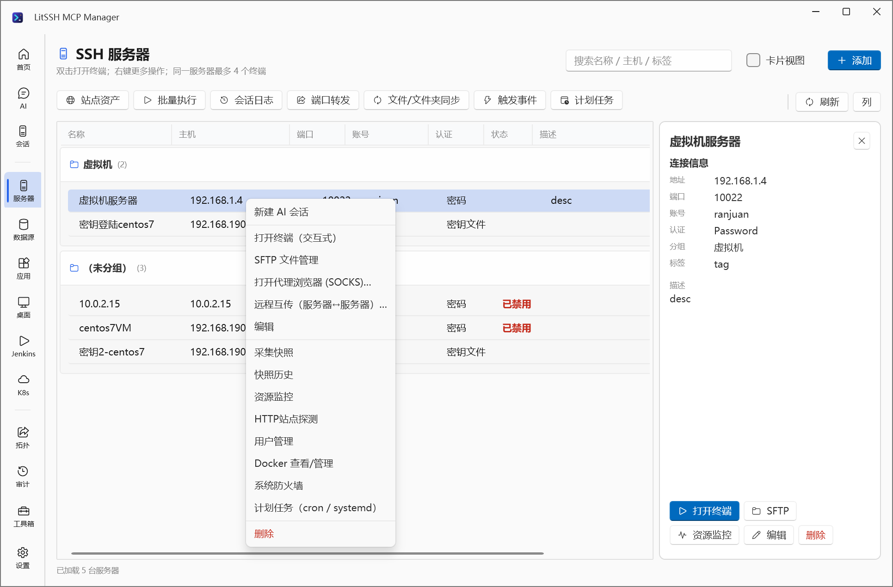<br><b>SSH 服务器管理</b></td>
<td width="50%">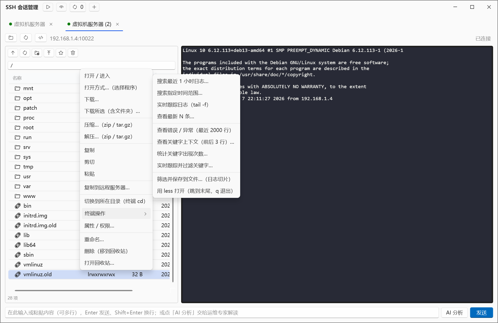<br><b>SSH 会话与 SFTP</b></td>
</tr>
<tr>
<td>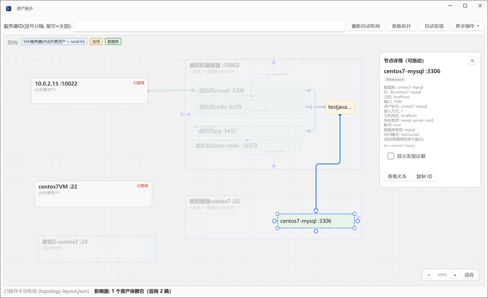<br><b>资产拓扑与影响面</b></td>
<td>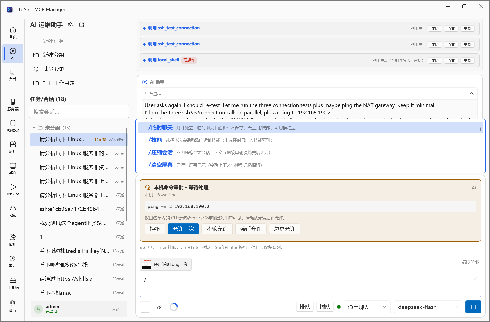<br><b>AI 运维助手</b></td>
</tr>
<tr>
<td>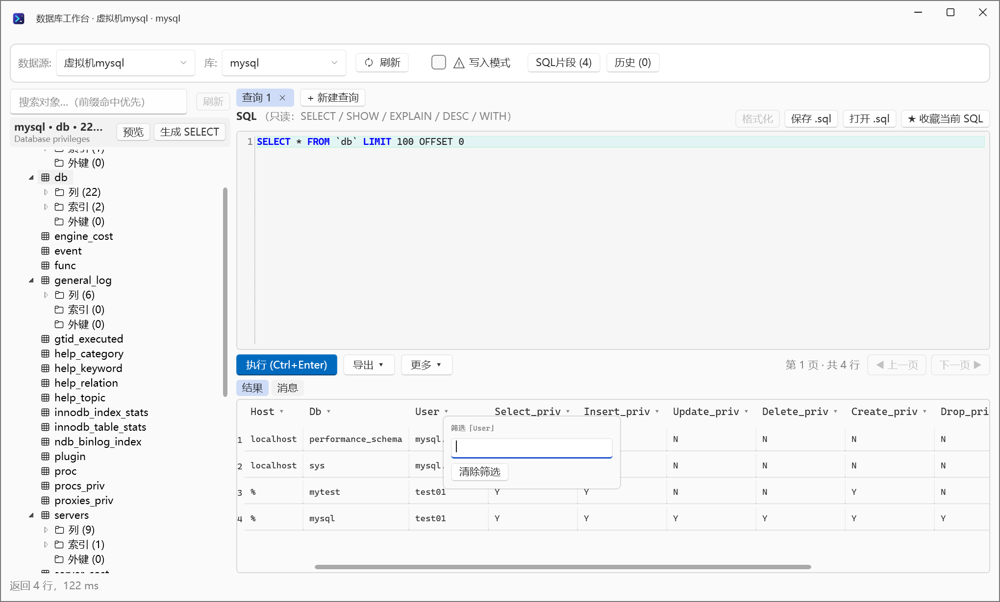<br><b>数据源工作台</b></td>
<td>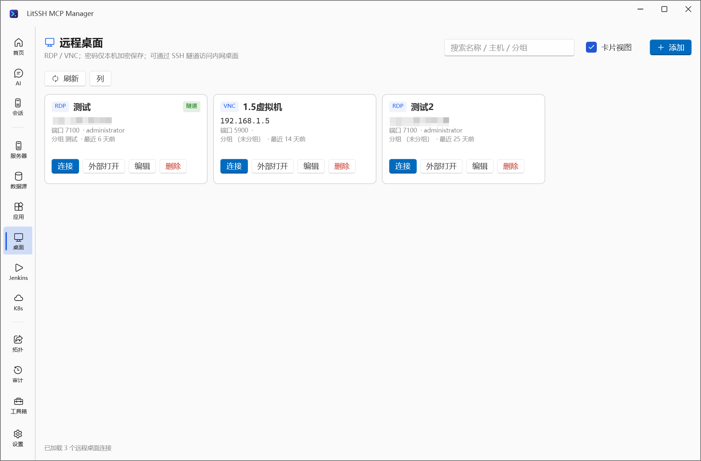<br><b>远程桌面 RDP / VNC</b></td>
</tr>
<tr>
<td>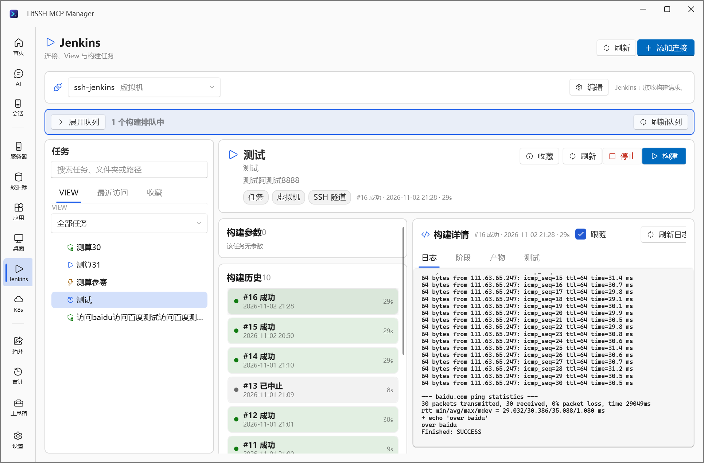<br><b>Jenkins 多连接</b></td>
<td>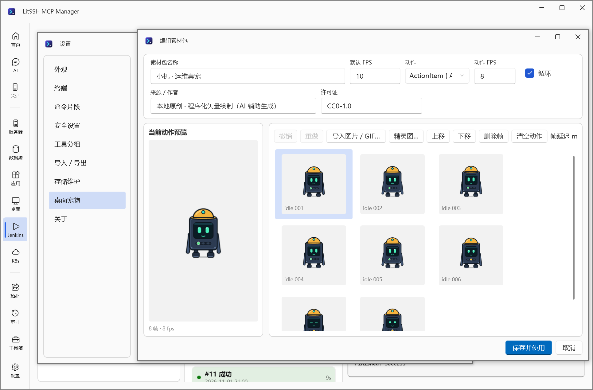<br><b>桌面宠物素材编辑器</b></td>
</tr>
<tr>
<td>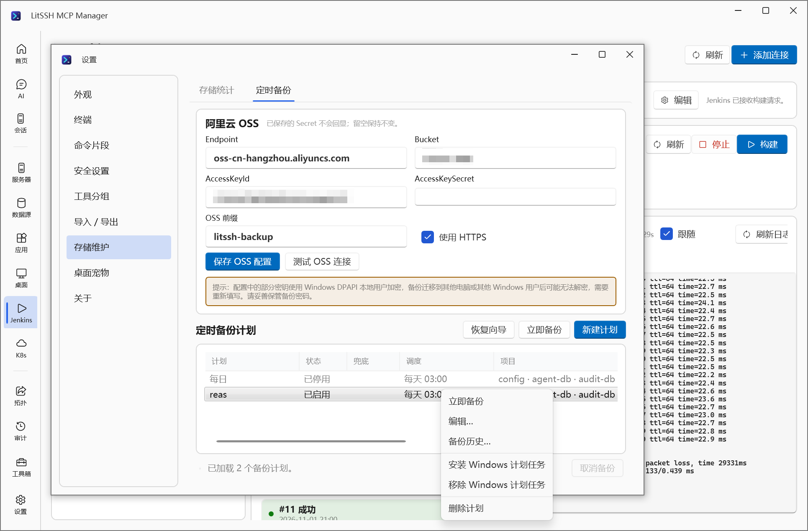<br><b>存储维护与定时备份</b></td>
<td>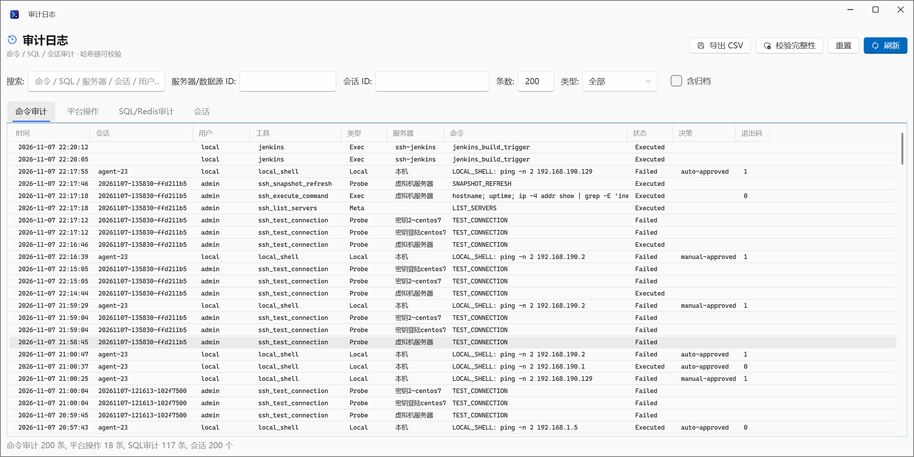<br><b>审计日志</b></td>
</tr>
<tr>
<td>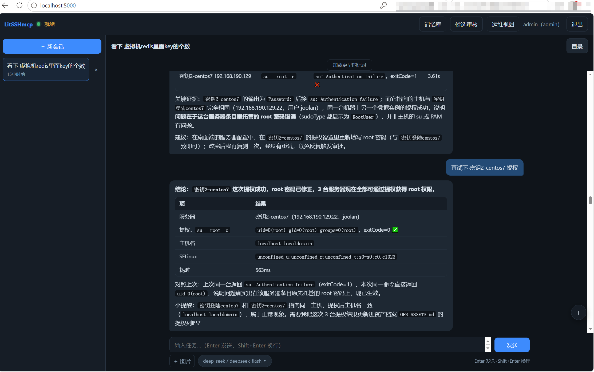<br><b>Web 运维助手</b></td>
<td>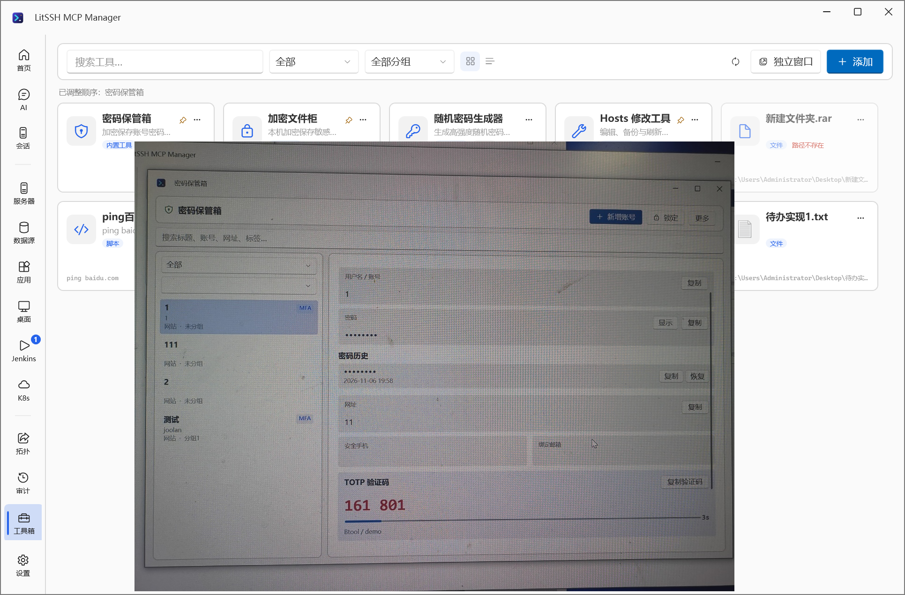<br><b>密码保管箱</b></td>
</tr>
</table>

## 三种使用方式

| 组成 | 项目 | 说明 |
|------|------|------|
| **MCP 服务** | `LitSSHmcp.McpServer` | stdio MCP 服务器，向 Claude Desktop / Cursor / Cline / CodeBuddy / opencode 等客户端暴露运维工具。 |
| **桌面 App** | `LitSSHmcp.App` | WPF 管理端（单实例）：服务器、数据源、应用、拓扑、远程桌面、Jenkins、Kubernetes、审计、桌面宠物、托盘常驻和内置 AI 助手（含 AI 定时任务）。 |
| **Web 助手** | `LitSSHmcp.Web` | 浏览器 AI 运维助手：独立账号、每会话独立子进程、流式聊天、Web 审批与文件下载。 |

## 核心能力

| 能力域 | 说明 |
|--------|------|
| SSH 运维 | 命令执行、sudo、连接测试、文件上传下载、目录浏览、整机快照 |
| 长任务 | `job_start` 后台执行、逐台进度、结构化结果、事件断点续读、取消与任务列表 |
| AI 运维助手 | Ops 专注 profile、统一意图路由、`ops_record` 知识沉淀、事件/资产画像、可信脚本哈希 |
| 批量变更 | 多机并发执行，计划 / 预检 / 金丝雀 / 回滚 |
| 数据源 | MySQL / PostgreSQL 查询、诊断、写操作审批；Redis 只读、写入与诊断 |
| 容器与服务 | Docker 容器 / 镜像 / 日志 / inspect / stats；systemd 状态与日志 |
| 日志与 Java | 日志检索、文件发现；Java 进程、线程栈、堆内存、JVM 信息 |
| 拓扑与体检 | 资产拓扑、上下游依赖、影响面、URL 落地、应用聚合体检 |
| 自动化 | 文件同步、触发事件、定时备份、AI 定时任务、Jenkins 构建与日志 |
| 本地工具箱 | 程序/文件/脚本启动、Hosts、密码与加密保管、证书/TLS 批量检测、文本/编码转换、SSH 密钥、本地端口/进程检查 |
| 安全审计 | 命令 / SQL 审计、审批链、哈希链完整性校验、Web 授权矩阵 |

详细桌面端能力见 [docs/APP_GUIDE.md](docs/APP_GUIDE.md)，Web 端见 [docs/WEB_GUIDE.md](docs/WEB_GUIDE.md)。

## MCP 工具

MCP 服务默认暴露 **41 个外部工具 + 1 个宿主内部审批工具**，覆盖 SSH、数据源、Docker、systemd、日志、Java、拓扑、应用体检、长任务和自检。完整参数、返回结构与“用户意图 → 工具”路由见 **[docs/TOOLS.md](docs/TOOLS.md)**。

可在 App 的“设置 → 工具分组”或 `config.json` 的 `tools.enabledGroups` 中裁剪工具分组：

```json
{
  "tools": {
    "enabledGroups": ["ssh", "command", "datasource", "mysql", "postgres", "redis", "docker", "service", "log", "java", "topology", "app", "jobs", "guide"]
  }
}
```

留空 / 不写 = 全部，`["all"]` = 全部，`["none"]` = 全部停用。

## 快速开始

### 环境要求

- Windows 10 / 11
- .NET 8 SDK（构建 CLI 需要 .NET 10 SDK）

### 编译与测试

```bash
git clone https://github.com/joolan/LitSSHmcp.git
cd LitSSHmcp
dotnet build LitSSHmcp.slnx
dotnet test LitSSHmcp.slnx
```

### 发布

```bash
# MCP 服务器
dotnet publish src/LitSSHmcp.McpServer -c Release -r win-x64 --self-contained -o publish

# 桌面 App（包含内置 MCP 服务器）
dotnet publish src/LitSSHmcp.App -c Release -r win-x64 --self-contained -o publish-app

# CLI
dotnet publish src/LitSSHmcp.Cli -c Release -r win-x64 --self-contained -o publish-cli

# Web 助手
dotnet publish src/LitSSHmcp.Web -c Release -r win-x64 --self-contained -o publish-web
```

也可以使用 `scripts\build-release.ps1` 一次产出四类发布物。

### 配置服务器

推荐启动桌面端：

```bash
dotnet run --project src/LitSSHmcp.App
```

在“SSH 服务器管理”页添加服务器（主机 / 端口 / 账号 / 密码或密钥 / 提权方式），随后可以连接终端、采集快照、查看拓扑，或把 MCP 服务接入 AI 客户端。

配置位置：`%APPDATA%\LitSSH\config.json`。完整字段见 [docs/CONFIGURATION.md](docs/CONFIGURATION.md) 和 [`config/config.example.json`](config/config.example.json)。

### 接入 AI 客户端

先发布得到 `LitSSHmcp.McpServer.exe`，再配置 MCP 客户端。以 Claude Desktop 为例：

```json
{
  "mcpServers": {
    "litssh": {
      "command": "C:\\path\\to\\publish\\LitSSHmcp.McpServer.exe"
    }
  }
}
```

Claude Desktop / Cursor / Cline / CodeBuddy / 开发模式配置见 [docs/MCP_CLIENT_SETUP.md](docs/MCP_CLIENT_SETUP.md)。

## 安全模型

- **应用锁**：启动密码 / Windows Hello，跟随 Windows 锁屏。
- **命令与 SQL 过滤**：危险命令 / SQL 直接拒绝；敏感操作进入审批。
- **审批通道**：桌面弹窗、CLI 带外审批，默认 45 秒超时拒绝。
- **凭据隔离**：SSH / 数据库密码仅本机 DPAPI 加密保存，不进入 AI 工具参数。
- **脚本安全**：脚本内容扫描命中危险模式默认硬拦截；可按完整 SHA-256 维护可信脚本，跳过内容硬拦截但仍强制人工审批。
- **文件传输**：本地 / 远程路径白名单、大小上限、上传下载审批。
- **主机密钥**：TOFU 首次记录指纹，变化即拒绝。
- **限流与连接复用**：按目标限制并发与调用频率，复用 SSH 连接避免触发登录告警。
- **审计**：命令 / SQL / 审批 / Web 拒绝写入审计库，HMAC-SHA256 哈希链可校验完整性。

详细安全模型、审批范围、Web 安全与 sudo 提权见 [docs/SECURITY.md](docs/SECURITY.md)，Web 端使用见 [docs/WEB_GUIDE.md](docs/WEB_GUIDE.md)。

## 使用示例

```text
在 Web 服务器上执行 df -h 查看磁盘空间
```

```text
订单服务报错了，帮我排查一下
```

```text
把本地的 config.yml 上传到服务器的 /etc/nginx/ 目录
```

更多排障链路、审批示例和 CLI 用法见 [docs/USAGE.md](docs/USAGE.md)。

## 命令行工具

```bash
litssh list                        # 列出所有服务器
litssh connect web-server          # 交互式连接
litssh run web-server "df -h"      # 执行单条命令
litssh approvals                   # 查看待审批
litssh approve <审批ID>            # 批准
litssh deny <审批ID>               # 拒绝
```

## 文档

| 文档 | 内容 |
|------|------|
| [docs/APP_GUIDE.md](docs/APP_GUIDE.md) | 桌面 App 使用指南：页面、终端、数据源、拓扑、AI 助手、设置 |
| [docs/WEB_GUIDE.md](docs/WEB_GUIDE.md) | Web 助手：启动、账号、安全边界 |
| [docs/ARCHITECTURE.md](docs/ARCHITECTURE.md) | 架构设计：分层、模块、安全、拓扑、线程模型、扩展点 |
| [docs/TOOLS.md](docs/TOOLS.md) | 41 个常规工具 + 1 个宿主内部工具完整参考 |
| [docs/CONFIGURATION.md](docs/CONFIGURATION.md) | `config.json` 配置字段与示例 |
| [docs/MCP_CLIENT_SETUP.md](docs/MCP_CLIENT_SETUP.md) | Claude Desktop / Cursor / Cline / CodeBuddy / 开发模式配置 |
| [docs/SECURITY.md](docs/SECURITY.md) | 安全模型、审批、Web 安全与 sudo 提权 |
| [docs/USAGE.md](docs/USAGE.md) | AI 使用示例、审批示例与 CLI 用法 |
| [docs/PET_ASSET_PACK.md](docs/PET_ASSET_PACK.md) | 桌面宠物素材包规范、制作、导入导出与备份 |
| [samples/pet-assets/README.md](samples/pet-assets/README.md) | 可直接导入的桌面宠物示例素材包（CC0-1.0） |
| [docs/CHANGELOG.md](docs/CHANGELOG.md) | 迭代历史 |
| [docs/UPGRADE_PLAN.md](docs/UPGRADE_PLAN.md) | 升级方案与 Roadmap |
| [docs/litssh-mcp-ops-skill/SKILL.md](docs/litssh-mcp-ops-skill/SKILL.md) | AI 排障 Skill |
| [docs/AGENT_HARNESS_REVIEW.md](docs/AGENT_HARNESS_REVIEW.md) | AI 运维助手设计评审 |

## 贡献

欢迎提交 Issue 或 Pull Request。架构与开发约定见 [docs/ARCHITECTURE.md](docs/ARCHITECTURE.md)。

## 许可证

本项目采用 **MIT 许可证**，见 [LICENSE](LICENSE)。

## 相关链接

- [Model Context Protocol](https://modelcontextprotocol.io/)
- [WPF-UI (Fluent)](https://github.com/lepoco/wpfui)
- [SSH.NET](https://github.com/sshnet/SSH.NET)
- [.NET 8](https://dotnet.microsoft.com/)

## 致谢

- 感谢 [Opencode](https://opencode.ai/) 作为开发助手参与本项目。
- 感谢所有开源依赖的维护者。
- 内嵌 VNC 使用 [noVNC](https://github.com/novnc/noVNC)（MPL-2.0），由 [WebView2](https://developer.microsoft.com/microsoft-edge/webview2/) 承载。

> 如有问题或建议，欢迎提交 [Issue](https://github.com/joolan/LitSSHmcp/issues)。
