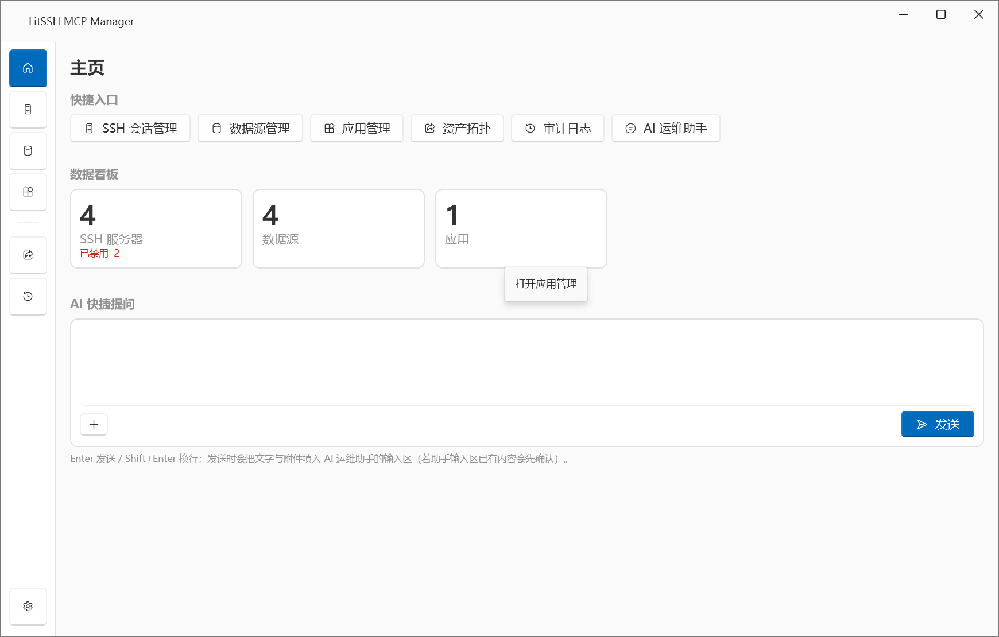
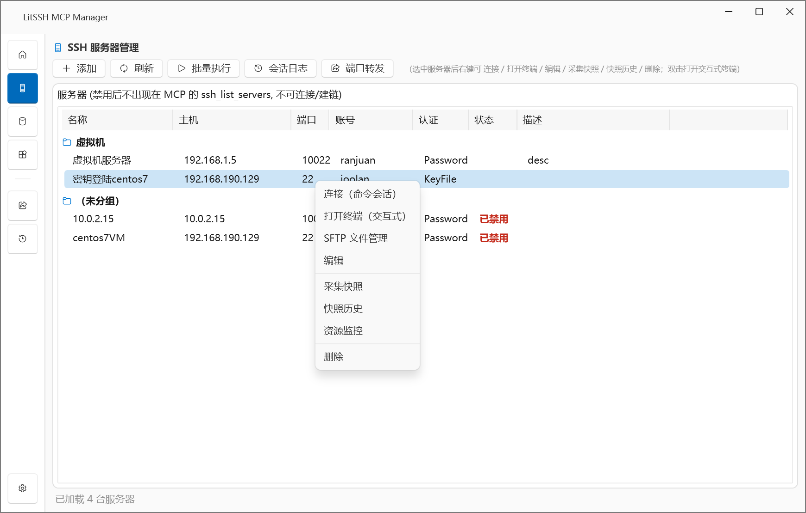
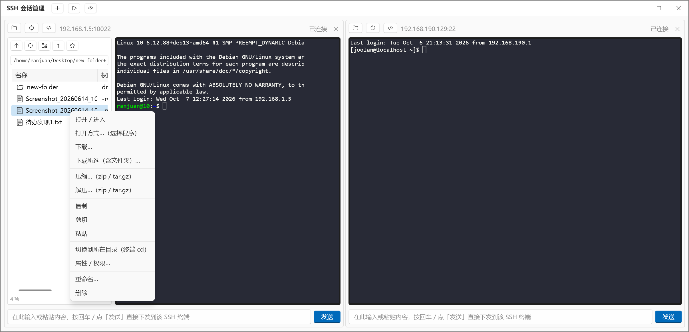
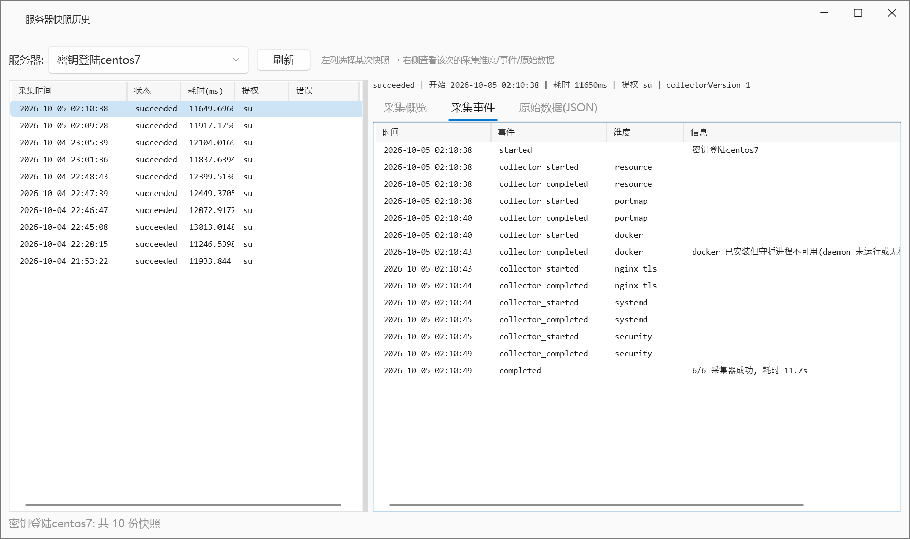
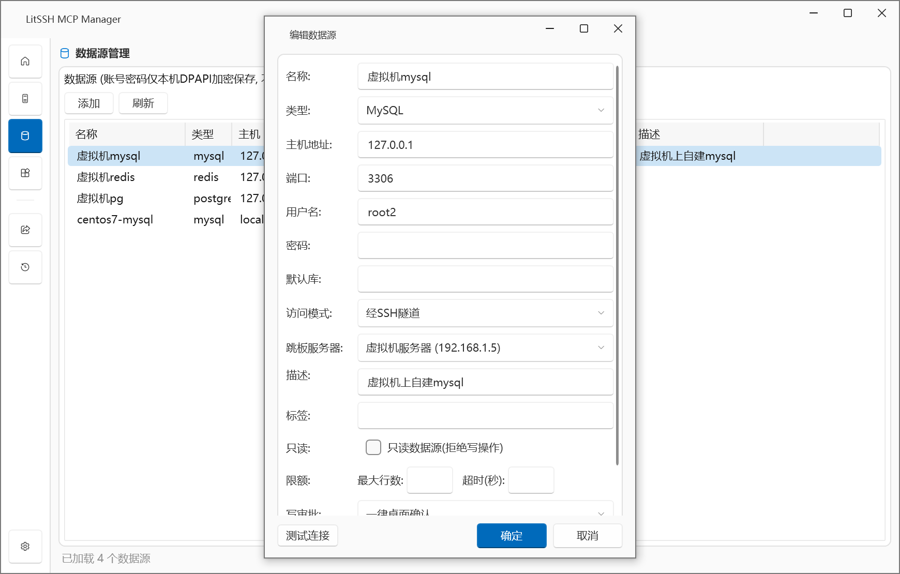
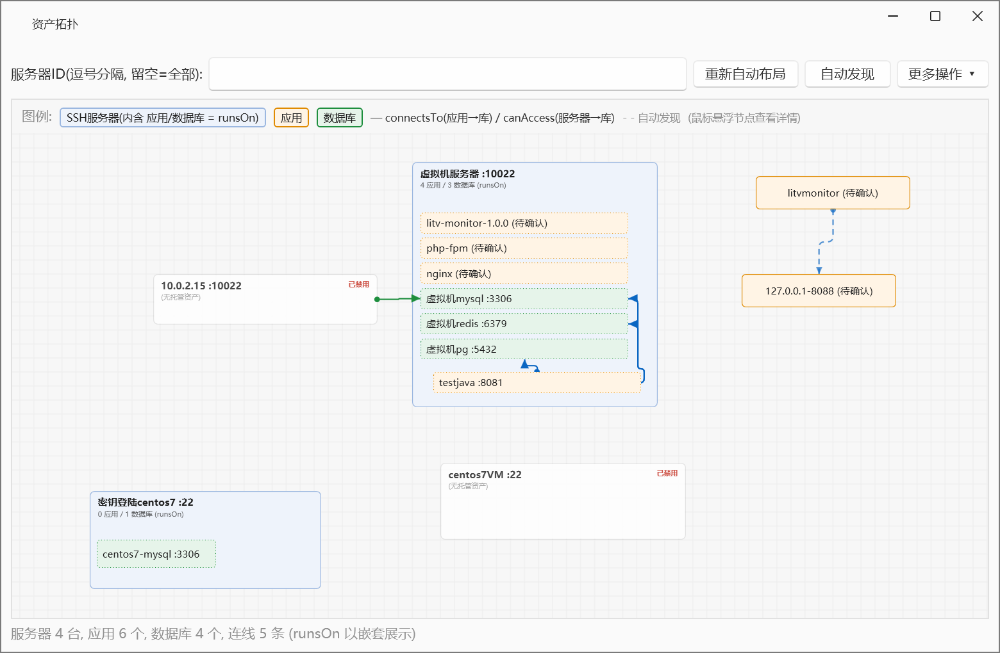
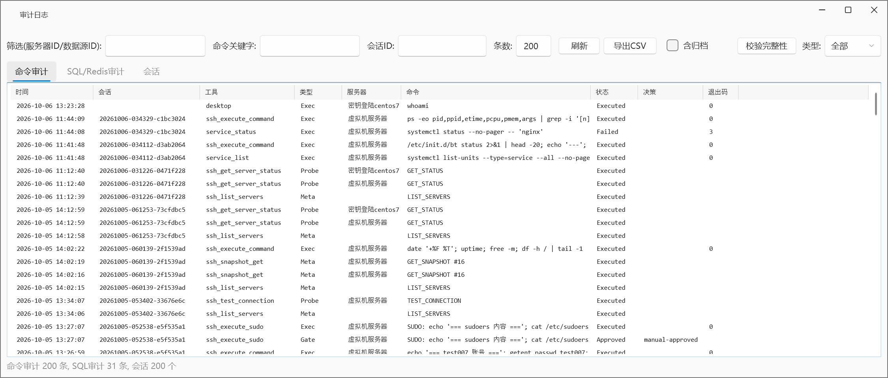
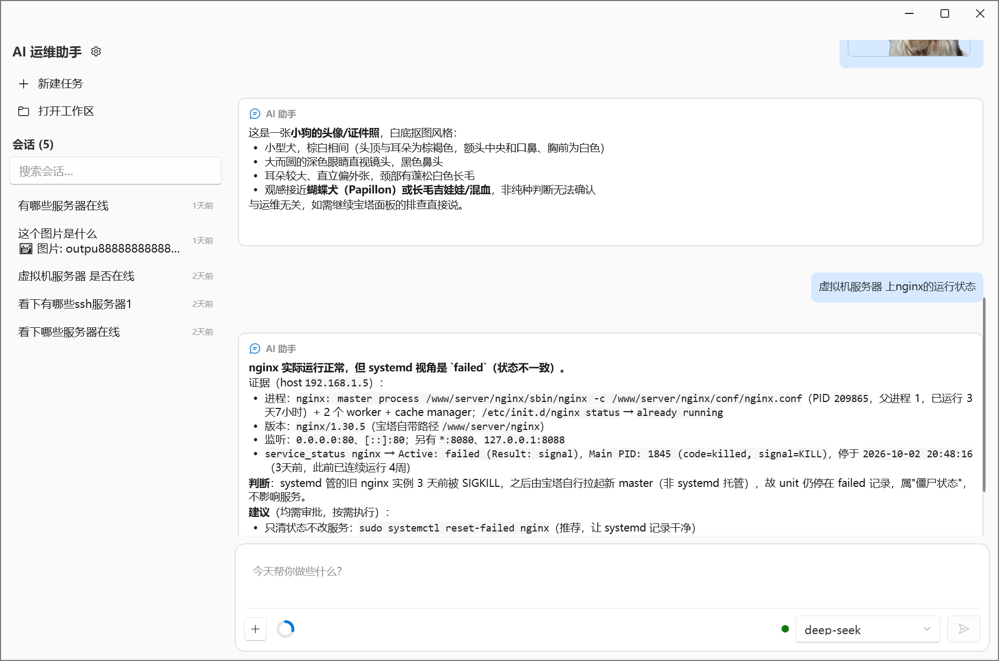
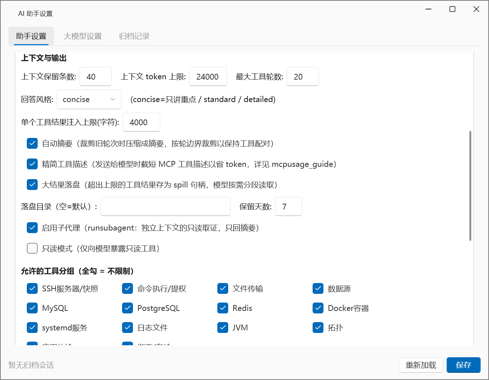

# LitSSH MCP

[](https://opensource.org/licenses/MIT)
[](https://dotnet.microsoft.com/)
[](https://windows.com/)
[](https://modelcontextprotocol.io/)
[](https://opencode.ai/)

> **让 AI 安全地运维你的服务器。** Windows 平台下的 **SSH / 数据库运维 MCP 服务器**，并配套一款 **WPF 桌面管理端（App）**——AI 智能体可通过 MCP 安全地管理远程 Linux 服务器，并贯通 **MySQL / PostgreSQL / Redis** 数据源与**资产拓扑**，支撑跨「服务器 / 应用(含 Docker 容器) / 数据库」的**全链路故障排查**。

<p align="center">
  
</p>

> 🤖 本项目使用 [Opencode](https://opencode.ai/) AI 助手开发。

## 📖 目录

- [项目简介](#项目简介)
- [MCP 服务](#mcp-服务)
- [桌面 App](#桌面-app)
- [Web 助手](#web-助手)
- [架构与技术栈](#架构与技术栈)
- [快速开始](#快速开始)
- [配置](#配置)
- [使用示例](#使用示例)
- [安全模型](#安全模型)
- [提权配置](#提权配置)
- [命令行工具 CLI](#命令行工具-cli)
- [文档](#文档)
- [贡献](#贡献)
- [许可证](#许可证)

## 项目简介

LitSSH MCP 由三部分组成，可**独立使用**，也可组合使用：

| 组成 | 项目 | 说明 |
|------|------|------|
| **🤖 MCP 服务** | `LitSSHmcp.McpServer` | 基于 [Model Context Protocol](https://modelcontextprotocol.io/) 的 stdio 服务器，向任意 MCP 客户端（Claude Desktop / Cursor / Cline / CodeBuddy / opencode 等）暴露 **61 个工具**，安全地执行 SSH、数据库、Docker、日志、Java、拓扑等运维操作。 |
| **🖥️ 桌面 App** | `LitSSHmcp.App` | WPF 管理端：可视化维护服务器/数据源/应用/资产拓扑，内置审计日志、MCP 工具说明，以及**内嵌 MCP 客户端的 AI 运维助手**。 |
| **🌐 Web 助手** | `LitSSHmcp.Web` | 浏览器访问的 AI 运维助手：独立账号登录、每个 AI 会话跑在**独立子进程**中，流式聊天、Web 内审批、服务器文件浏览与下载。 |

**核心亮点**

- 🔒 **安全默认**：命令 / SQL 过滤、敏感操作桌面审批、文件路径白名单、TOFU 主机密钥校验、按目标限流、**HMAC-SHA256 哈希链审计**。
- 🔑 **凭据隔离**：SSH / 数据库密码仅在本机 **DPAPI 加密**保存，工具入参与出参**均不包含密码**，AI 只能通过 `datasourceId` 引用数据源。
- 🧭 **全链路排障**：资产拓扑 + 整机快照 + 应用聚合体检，从「应用 → 服务器 → 数据库」贯通。
- 🤖 **内置 AI 运维助手**：App 内配置 OpenAI 兼容大模型，通过内嵌 MCP 客户端调用全部工具，安全策略与第三方客户端完全一致。

## MCP 服务

MCP 服务是纯粹的 stdio 进程，不依赖桌面界面；把它配置到任意 MCP 客户端，AI 即可安全地操作你的服务器与数据库。

### 能力概览

| 能力域 | 说明 |
|--------|------|
| **SSH 运维** | 命令执行、sudo 提权、连接测试 / 状态、文件上传下载（含批量 / 目录）、目录浏览、整机快照 |
| **数据源** | MySQL / PostgreSQL 只读查询、执行计划、写操作与诊断；Redis 只读与写 / 管理命令、诊断；支持直连或 SSH 隧道 |
| **容器与服务** | Docker 容器 / 镜像 / 日志 / inspect / stats；systemd 服务状态与日志 |
| **日志与 Java** | 日志按关键字 / 正则检索、日志文件发现；Java 进程 / 线程栈 / 堆内存 / JVM 信息 |
| **拓扑与体检** | 资产拓扑总览、上下游依赖查询、拓扑自动发现；按应用聚合体检 |
| **辅助** | 使用指南、MCP 自检、会话列表 |

除工具外，服务还通过 MCP **Resources** 暴露**只读上下文**（供客户端“浏览 / 挂载”，无需调用工具）：`litssh://servers`（服务器清单）、`litssh://datasources`（数据源清单）、`litssh://usage-guide`（使用指南）、`litssh://topology`（资产拓扑）、`litssh://server/{id}/snapshot/latest`（资源模板：某服务器最新快照概览）。资源**不含密码/密钥**、禁用服务器已排除，并按**启用的工具分组**暴露。

<details>
<summary><b>查看全部 61 个工具</b>（点击展开）</summary>

> 完整参数 / 返回结构 / "用户意图 → 工具" 路由表见 **[docs/TOOLS.md](docs/TOOLS.md)**（唯一事实来源）。工具发生变动时，MCP 服务器端注解、`docs/TOOLS.md`、App 展示三处必须同步。

| Tool | 描述 |
|------|------|
| `ssh_list_servers` | 列出所有已配置的SSH服务器（已禁用的服务器不会出现） |
| `ssh_execute_command` | 在指定服务器执行Shell命令 |
| `ssh_execute_sudo` | 使用提权执行命令（权限不足时使用） |
| `ssh_get_sudo_status` | 获取服务器提权配置状态 |
| `ssh_get_server_status` | 获取服务器连接状态 |
| `ssh_test_connection` | 测试SSH连接 |
| `ssh_snapshot_get` | 查询服务器整机快照（资源/端口进程服务/Docker/nginx证书/systemd/**安全巡检**）；**默认返回各维度概览**，`section=` 取单维度完整数据、`detail="full"` 取全部，可查历史 |
| `ssh_snapshot_refresh` | 重新采集服务器整机快照（耗时较长、同机单飞；**有最短刷新间隔节流**，`force=true` 强制重采；失败也落库） |
| `ssh_get_command_history` | 查看命令执行历史 |
| `ssh_upload_file` | 上传本地文件到服务器 |
| `ssh_upload_files` | **批量/目录上传**（一条 SFTP 连接、整批一次审批、保留子目录结构） |
| `ssh_download_file` | 从服务器下载文件到本地 |
| `ssh_download_files` | **批量/目录下载**（一条 SFTP 连接、整批一次审批、保留子目录结构） |
| `ssh_list_files` | 浏览服务器目录 |
| `datasource_list` | 列出MySQL/PostgreSQL/Redis等数据源（主机/端口/账号/绑定关系，**无密码**） |
| `datasource_test_connection` | 测试数据库连通性（直连或SSH隧道） |
| `mysql_query` | 只读SQL查询（SELECT/SHOW/EXPLAIN） |
| `mysql_execute` | 写SQL（危险语句拒绝，敏感语句桌面审批） |
| `mysql_explain` | SQL执行计划分析 |
| `mysql_diagnostics` | MySQL诊断：连接数/慢查询/锁/复制/进程列表 |
| `postgres_query` | 只读SQL查询（PostgreSQL） |
| `postgres_execute` | 写SQL（PostgreSQL，危险语句拒绝，敏感语句审批） |
| `postgres_explain` | SQL执行计划分析（PostgreSQL） |
| `postgres_diagnostics` | PostgreSQL诊断：连接/活动会话/等待锁/复制/缓存命中/死锁 |
| `redis_read` | Redis只读命令（GET/HGETALL/INFO/SCAN/SLOWLOG等白名单） |
| `redis_execute` | Redis写/管理命令（一律桌面审批，危险命令直接拒绝） |
| `redis_diagnostics` | Redis诊断：内存/客户端/命中率/键空间/慢日志/主从/持久化 |
| `datasource_get_sql_history` | SQL与Redis命令审计历史（带 sessionId/tool，可过滤） |
| `docker_ps` | 列出Docker容器（结构化：名称/镜像/状态/端口） |
| `docker_logs` | 查看容器日志 |
| `docker_inspect` | 容器详情（inspect：环境/挂载/网络/健康检查） |
| `docker_stats` | 容器资源占用快照（CPU/内存/网络/磁盘IO） |
| `docker_images` | 镜像列表（版本/大小） |
| `docker_restart` | 重启容器（需审批） |
| `docker_exec` | 容器内执行命令（需审批） |
| `service_status` | systemd 服务状态 |
| `service_list` | 列出 systemd 服务 |
| `service_restart` | 重启 systemd 服务（需审批） |
| `service_logs` | 服务日志（journalctl） |
| `log_tail` | 查看日志文件尾部（可传 path 或 appId） |
| `log_grep` | 日志按关键字/正则检索（可传 path 或 appId） |
| `log_find` | 发现最近修改的日志文件（不知路径时先用它） |
| `java_processes` | 列出 Java 进程（可传 appId 过滤） |
| `java_threads` | 抓取线程栈（jstack，可传 appId 自动解析 pid） |
| `java_heap` | 堆内存/GC（jcmd + jstat） |
| `java_info` | JVM 版本/运行时长 |
| `app_health_snapshot` | 按应用聚合体检（所在服务器进程/容器/端口 + 依赖数据源连通性） |
| `topology_get_overview` | 资产拓扑图（服务器/应用/服务/容器/部署/数据库/域名/端口/证书及关系） |
| `topology_get_dependencies` | 查询某资产的上下游依赖 |
| `topology_discover` | 自动发现拓扑（java/服务进程/端口/ESTAB/JDBC/Redis/RabbitMQ/Kafka/Nginx/docker/processlist；并从最近快照入库服务/容器/部署/域名/端口/证书；有节流） |
| `topology_search` | 按名称/ID/主机/端口/标签搜索资产，拿到精确 ID |
| `topology_neighbors` | 查某资产的邻域（入边+出边，可多跳） |
| `topology_path` | 查两个资产之间的有向链路（域名→应用→库） |
| `topology_impact` | 反向查影响面（机器/库/证书变更影响谁） |
| `topology_explain` | 解释依赖边：来源/证据/末次发现/是否过期/冲突原因 |
| `topology_timeline` | 按快照历史重放拓扑，标出每次新增/移除的服务、容器、端口、域名、证书 |
| `topology_diff` | 比较两次快照的节点/边差异（默认最近两次） |
| `mcp_usage_guide` | 获取使用指南 |
| `mcp_self_check` | MCP 自检（配置/审计/主机密钥，可测连通性；返回当前会话ID/客户端） |
| `mcp_list_sessions` | 列出最近 MCP 会话（会话ID/客户端/首末活动） |

</details>

**工具分组（按部署裁剪）**：默认暴露全部 61 个工具；可在 App 的 **设置 → 工具分组** 勾选，或直接改 `config.json` 的 `tools.enabledGroups`，只启用需要的分组（`ssh` / `command` / `fileTransfer` / `datasource` / `mysql` / `postgres` / `redis` / `docker` / `service` / `log` / `java` / `topology` / `app` / `guide`），降低 AI 上下文占用与误选。留空 / 不写 = 全部，`["all"]` = 全部，`["none"]` = 全部停用。

**AI 排障 Skill**：仓库内置 [`docs/litssh-mcp-ops-skill/SKILL.md`](docs/litssh-mcp-ops-skill/SKILL.md)（工具无关，随仓库分发），供支持 skills 的 AI 智能体（opencode / Claude 等）使用。内容包含工具路由、标准排障流程、日志路径发现，以及 **MCP 未覆盖能力经 SSH 变通**的方案（如按 Java 启动命令 / 配置文件定位日志后再用 `log_tail`）。可复制到对应智能体的 skill 目录，或在 opencode 中用 `skills.paths` 指向该目录。

### 在 AI 客户端中配置 MCP

先发布（见 [快速开始](#快速开始)）得到 `LitSSHmcp.McpServer.exe`，再按客户端填入配置。

<details>
<summary><b>Claude Desktop</b>（编辑 <code>%APPDATA%\Claude\claude_desktop_config.json</code>）</summary>

```json
{
  "mcpServers": {
    "litssh": {
      "command": "C:\\path\\to\\publish\\LitSSHmcp.McpServer.exe"
    }
  }
}
```
</details>

<details>
<summary><b>Cursor / Windsurf</b>（编辑 <code>.cursor/mcp.json</code>）</summary>

```json
{
  "mcpServers": {
    "litssh": {
      "command": "C:\\path\\to\\publish\\LitSSHmcp.McpServer.exe"
    }
  }
}
```
</details>

<details>
<summary><b>Cline (VS Code)</b>（编辑 <code>.vscode/mcp.json</code>）</summary>

```json
{
  "servers": {
    "litssh": {
      "command": "C:\\path\\to\\publish\\LitSSHmcp.McpServer.exe"
    }
  }
}
```
</details>

<details>
<summary><b>CodeBuddy</b>（编辑 <code>~/.codebuddy/.mcp.json</code>）</summary>

```json
{
  "mcpServers": {
    "litssh": {
      "type": "stdio",
      "command": "C:\\path\\to\\publish\\LitSSHmcp.McpServer.exe"
    }
  }
}
```
</details>

<details>
<summary><b>开发模式（使用 dotnet run）</b></summary>

```json
{
  "mcpServers": {
    "litssh": {
      "command": "dotnet",
      "args": ["run", "--project", "C:\\path\\to\\LitSSHmcp\\src\\LitSSHmcp.McpServer", "--no-build"]
    }
  }
}
```
</details>

### 验证

重启 AI 客户端后，输入以下内容测试：

```
请列出所有SSH服务器
```

AI 会调用 `ssh_list_servers` 工具返回服务器列表。

## 桌面 App

WPF 桌面管理端，主界面为**左侧图标导航栏 + 右侧页面**：顶部依次为 **主页 / SSH 服务器管理 / 数据源管理 / 应用管理 / 远程桌面**（页面形式）；分割线以下为 **资产拓扑 / 审计日志**（独立非模态窗口，不置顶，可同时操作主界面）；**最下方为「设置」**（外观 / 终端 / 命令片段 / 安全设置 / 工具分组 / 导入导出 / MCP 工具说明 / 关于）。**AI 运维助手**（内置大模型运维智能体）从主页快捷入口或 AI 快捷提问打开。

### 主页看板

**快捷入口**（SSH 会话管理 / 资产拓扑 / 审计日志 / AI 运维助手）、**数据看板**（SSH 服务器总数与禁用数、数据源数、应用数、端口转发规则、远程桌面、同步任务、触发事件；点卡片可跳到对应管理页）、**AI 快捷提问**（输入问题或添加附件后发送，会填入 AI 运维助手输入区）。


### SSH 服务器管理与会话

**SSH 服务器管理**页提供服务器表格：顶部仅 **添加 / 刷新**，其余操作走条目**右键菜单**（连接 / 编辑 / 采集快照 / 快照历史 / 删除），**双击**行打开编辑窗口，支持列排序。右键**「连接（命令会话）」**或**「打开终端（交互式）」**打开独立的 **「SSH 会话管理」多标签窗口**（非模态、不置顶）。命令会话标签可执行命令、查看输出与最近活动、测试连接；**终端标签**为交互式 PTY shell（自绘 VT100/ANSI，支持 `vim`/`top`/`htop`/`less`、颜色、滚动回看、窗口自适应），且**左侧分栏内嵌服务器文件可视化**（SFTP：目录导航、上传 / 下载、新建文件夹、重命名、删除，双击文件下载并打开）。





**会话可分离为独立窗口**：在**标签布局**拖动标签、在**平铺（卡片）布局**拖动卡片头把手，**拖离窗口松手**即把该会话弹出为一个**独立、紧凑、可缩放、可自由摆放**的窗口（位置/尺寸按会话记忆）；独立窗口右上角有「收回」（送回主窗口）与「✕ 关闭会话」，标签/卡片右键也有「分离为独立窗口」。终端连接状态由会话 VM 持有，分离/收回**不重连、不断开**。

**服务器连接增强**：服务器可配置 **跳板机（ProxyJump，经另一台已配置服务器中转）**、**生成 SSH 密钥**（ed25519 / rsa(4096)，优先系统 `ssh-keygen`、缺失回退内置 RSA；生成后展示 **OpenSSH 公钥**一键复制到目标机 `~/.ssh/authorized_keys`）、以及**凭据轮换提醒**（凭据变更自动刷新更新时间、超期在编辑窗口提示）。跳板机在 **SSH 连接工厂统一生效**，故**终端（含文件管理）/ SFTP / 命令 / 同步 / 拓扑发现 / MCP 工具（含连接复用）/ 数据源隧道 / 端口转发**均自动支持（仅**单级**跳板；跳板机不能与目标同 Host、不能选自身；`litssh` CLI 与 rsync 源↔目标直连路径亦带 `-J`）。

**批量执行 / 快速命令**：SSH 服务器管理页 **「批量执行」** 打开多机并行执行窗口，内置一排**快速命令**（一键巡检、磁盘 / inode / 内存 / 占用端口 / CPU·内存 Top / 大目录 / 最近日志 / Docker 容器 / 网络地址）与 **「一键巡检」**；写操作以 `⚠` 标注并在执行前**弹确认**。

**会话录像 / 回放**：交互式终端会话（`terminal.recordSessions` 默认开）以 **asciicast v2（`.cast`）** 记录输入/输出的**时间戳**，「会话日志」窗口对其提供**播放 / 暂停 / 重开 / 倍速（1/2/4/8x）**回放（去 ANSI 文本渲染），并保留原 `.log` 纯文本；录制过程中也可打开查看，刷新列表即可看到新增内容。

**日志文件「终端操作」**：在交互式终端左侧远程文件面板选中文件，右键 **「终端操作」** 可把命令直接发送到右侧终端（仅在终端已连接、回到 shell 提示符且未运行全屏程序时发送，否则提示原因）。内置 **最近 1 小时 / 指定时间范围搜索、`tail -f` 实时跟踪、最新 N 条、错误 / 异常过滤、关键字上下文与计数、实时过滤、`less` 末尾打开（`q` 退出）**，以及 **「筛选并保存到文件…」日志切片**（按关键字 / 时间 / 扫描行数过滤后写入远端文件，默认同目录 `*.slice-yyyyMMdd-HHmmss.log`，完成后刷新文件列表即可下载；输出路径须为绝对路径且不能与源文件相同）。时间过滤支持行首 ISO、nginx 错误日志 `yyyy/MM/dd` 与 nginx/Apache 访问日志 `[dd/Mon/yyyy:HH:mm:ss`；syslog 建议改用关键字 / 最新 N 条。发送成功后自动把键盘焦点移回终端；文件面板底部状态固定单行省略、悬浮显示完整内容，避免挤压列表。

**跨机复制（源→目标，走服务器间内网通道）**：两个入口——① **SSH 服务器管理**条目右键 **「远程互传（服务器↔服务器）…」**（左右两侧均为可切换的服务器文件浏览器，左侧多选源文件）；② 会话的远程文件面板**多选**后右键 **「复制到远程服务器…」**，弹窗左侧为待复制列表、右侧选择**其它服务器**（可切换 **主机地址 / 内网地址**）并浏览目标目录，确认后由**源服务器直接推送**到目标（优先 `rsync`，退化 `tar | ssh`，可 `-z` 压缩），**数据不经本机磁盘**、利用服务器间内网高速通道；认证优先源机免密，其次 `sshpass` + 目标密码（密码经 stdin 写入源机 0600 临时文件，不进命令行）；若源机**缺 `sshpass`** 会**弹出安装引导框**（按发行版给出 `apt-get`/`yum`(含 EPEL)/`dnf`/`zypper`/`pacman`/`apk` 命令，可复制），安装后点「已安装，重试」；直连不可用时默认报错，勾选「直连失败时询问是否内存中转」后会**弹窗让用户确认**是否改用**经本机内存中转**（不落盘）；传输完成后**自动刷新目标文件列表**。跨机复制使用的**内网地址 / 内网端口**在服务器配置中可选填写。

**文件 / 文件夹同步（单向）**：SSH 服务器管理页 **「文件/文件夹同步」** 按钮 → 独立窗口创建多个任务，方向支持 **本地→远程 / 远程→本地 / 远程→远程**（仅单向）；默认**只新增/更新、不删除**，「镜像删除目标端多余文件」为**显式选项**；**「测试」为可选自检**（实际传一个探针文件验证连通与认证，不再作为保存前置）；调度支持 **固定间隔 / 每周固定时刻（多选周几） / 每月固定（多选日期 1-28）**；失败按**指数退避重试（≤5 次）**；**仅 App 运行期间执行**。本地↔远程用自研 SFTP 比对/传输引擎（`size + mtime`，临时文件 + rename 原子落盘）；远程↔远程走**服务器端 `rsync` 直连**（不经本机，测试前校验两端是否安装 rsync，缺失给出该端发行版安装命令）。任务可设 **「仅同步 / 排除」文件过滤**（glob，支持 `*` `?`）与 **「使用内网地址」**（远程↔远程，经目标内网地址连接）。**测试 / 保存 / 立即运行**的结果以**模态弹窗**展示（正文可复制），失败时给出**源机免密配置命令**（`ssh-keygen` / `ssh-copy-id` / 验证命令）或 sshpass+密码替代路径。路径支持**「选择文件夹」**（本地）与**「浏览远程」**（服务器目录回填）。

**触发事件（git / webhook / 备份）**：SSH 服务器管理页 **「触发事件」** 按钮（或主页「触发事件」看板卡片）→ 独立窗口创建多个触发事件，可对**本机或远程服务器**按顺序执行一条**动作流水线**：**Git 提交推送**（`status`→`add -A`→`commit`→`push`，无变更自动跳过）、**Webhook 通知**（通用 JSON / 钉钉 / 企业微信 / 飞书；`{{变量}}` 模板 + 钉钉/飞书加签，密钥 DPAPI 加密）、**目录备份**（Zip / TarGz 打包到输出目录，可「保留最近 N 份」自动清理最旧；远程优先 `tar`、缺失回退 `zip`）、**数据库备份**（MySQL / PostgreSQL，**整库或指定表**，产物 SQL 转储、可选 gzip 压缩为 `.sql.gz`，可「保留最近 N 份」；输出目录随执行目标：目标=本机则在本机执行落盘（需本机 `mysqldump` / `pg_dump`，经 SSH 隧道的数据源自动建隧道，探测不到工具时退化为**托管流式导出**），目标=远程服务器则在服务器上执行并落盘到**服务器目录**（需服务器已装客户端工具且能访问该数据库）；受**全局备份并发数**约束，避免多任务同时 dump 压垮本机 / 目标）。**触发源**可叠加：**手动「立即执行」**、**定时**（固定间隔 / 每周 / 每月，复用同步调度模型）、**被同步任务「事件触发」**（在触发事件里勾选「允许被同步任务事件触发」，再到「文件/文件夹同步」任务末尾选择本事件及条件：**无条件触发** / **仅同步成功时触发**）。单步失败默认中断后续，可勾选**「失败后继续」**（如失败也要发通知）；失败按**指数退避重试（≤5 次）**；git、目录备份与数据库备份写入审计库；**仅 App 运行期间生效**。窗口内 **「总览」** 只读可视化每个触发事件的启用/目标/同步触发、**调度描述 + 下次运行 + 上次结果**与**动作流水线**（步骤卡片 → 箭头，标注失败中断/继续）。

**关闭主窗口**时可选**「最小化到托盘」**（后台继续运行，SSH 会话 / AI 任务不受影响；**已打开的独立窗口一并隐藏**，双击托盘图标恢复——**已启用应用锁时恢复前需先解锁**，恢复时先前隐藏的窗口一并显示；右键菜单可显示主界面 / 退出）或**「退出程序」**（**连同所有独立窗口一起退出**：AI 助手 / 审计日志 / 资产拓扑 / SSH 会话管理 / 远程桌面 / 同步 / 触发事件 / 设置等，不再残留）。

**采集快照**会连服务器采集整机态势（资源 / 端口进程服务 / 证书 / systemd 健康 / 安全巡检，同步、典型 10~30 秒，同一服务器同时只允许一个），完成后打开**快照历史窗口**：可切换服务器，左列历史列表 → 右侧查看该次快照的**采集维度概览 / 采集事件 / 原始数据**；窗口内 **「趋势图」** 用该服务器最近成功快照画 **内存% / 磁盘%(最大分区) / Swap% / 负载%(1m/核)** 折线（轻量自绘图，无第三方图表库）。



### 数据源与应用管理

- **数据源管理**：维护 MySQL / PostgreSQL / Redis 等数据源；顶部 **添加 / 刷新**，条目**右键菜单**为 测试连接 / 编辑 / 删除，双击也可编辑（类型切换时自动带出默认端口 3306/5432/6379）；可设置**治理**项（只读、最大行数、超时、写审批策略）。密码仅本机 DPAPI 加密保存、不对 AI 开放。删除时会提示并级联清理引用它的关系。顶部 **「打开工作台」** 或右键 **「打开工作台（只读查询）」**（MySQL / PostgreSQL / Redis 可见，打开即定位到该数据源）进入**数据库工作台**：SQL 数据源支持对象浏览（库 → 表 → 列，含类型图标、选中对象面包屑与搜索匹配计数）、SQL 查询、表数据分页预览，Redis 支持 **键浏览**（分批 `SCAN` 时间预算续扫、键值有界读取、补全类型/TTL/大小、顶部 DB 切换、大结果集命令执行前警告）与命令输入；两者均有 **片段**（按「数据源 · 库」收藏、点击追加）、**结果复制**（复制单元格 / 整行 / 全部、双击查看完整内容）与 **导出 CSV**；顶部 **只读 / 写入模式**切换（默认只读，写入模式标题、SQL 框、执行按钮与结果区均以红/橙强区分）；写操作复用安全链（危险语句硬拦截 + **执行前预览确认**：展示 SQL 与预计影响行数/样本行 + 执行后成功失败弹窗提示 + 审计），只读数据源不可开启写入。
- **应用管理**：维护 `app:` 应用节点（名称 / 类型 / 端口 / 主机 / 描述）；Docker 应用把类型填 `docker` 并填**容器名**（与 `docker ps` 的 NAMES 一致），AI 即可用 SSH 工具管理；顶部 **添加 / 刷新**，条目**右键菜单**为 编辑 / 删除，双击也可编辑。



### 远程桌面（RDP / VNC）

独立的**「远程桌面」**管理页（左侧导航 / 主页数据看板卡片进入）：可**添加、管理并连接** RDP / VNC 远程桌面。连接支持协议（RDP / VNC，切换时自动带出默认端口 3389 / 5900）、主机 / 端口、账号 / 密码（仅本机 **DPAPI 加密**保存，永不对 AI 开放）/ 域，**可经某台已配置的 SSH 服务器建立隧道**（复用端口转发服务，含 **ProxyJump** / 主机键策略 / 断线重连——可访问**只在堡垒机后可达的内网桌面**），以及全屏、自动填充凭据、**RDP 分辨率下拉预设**（自适应 / 1280×720 / 1600×900 / 1920×1080 / 2560×1440 / 3840×2160 / 自定义）、VNC 查看器路径（留空自动探测 TigerVNC / TightVNC / RealVNC / UltraVNC）、分组 / 标签 / 描述。每次连接**写入审计**。配置持久化到 `config.json` 的 `remoteDesktops`。

**连接方式**（管理页「连接」/ 双击 = 内嵌窗口）：

- **内嵌窗口（默认）**：多标签的「远程桌面」窗口（自绘顶部栏，标签样式与「SSH 会话管理」一致），标签内容常驻（切标签不重连），**标签可拖出分离为独立窗口 / 收回**（分离窗口自带「收回」按钮；标签右键亦可分离），关闭标签需二次确认。
  - **RDP**：用系统自带 **RDP ActiveX 控件**（`mstscax.dll`，经 `WindowsFormsHost` 承载）在窗口内渲染。
  - **VNC**：用 **WebView2** 承载随包分发的 **noVNC** 页面（`Assets/novnc/`，MPL-2.0），经本机回环的 WebSocket 桥（`/websockify`）连到目标 VNC（可经 SSH 隧道）。
- **外部客户端**：管理页「用外部客户端打开」——RDP 调用系统 `mstsc`（口令经 Windows 凭据管理器 `cmdkey` 暂存）、VNC 调用本机查看器；**查看器退出后自动拆除隧道**。

> 环境要求：RDP 依赖系统 RDP 组件（Windows 自带）；内嵌 VNC 依赖 **Microsoft Edge WebView2 运行时**（通常随 Edge/Windows 预装，缺失时给出安装提示）。后续计划：拓扑、`.rdp`/`.vnc` 导入导出、MCP 只读清单。

### 资产拓扑（可视化编辑）

一张可交互画布，服务器 / 应用 / 数据库及关系可视化（`runsOn` 内嵌、`connectsTo` / `canAccess` 避障正交连线 + 圆点 / 箭头 / 过桥），支持**直接编辑**：

- **拖动**节点（拖服务器带动其内子节点）、**缩放**节点（四角手柄 + 四边内侧直接拉伸）；
- 从节点**边中点端口**拖到另一节点创建关系（自动推断类型并做逻辑校验）；
- **点选连线**后右侧出现**关系属性面板**：修改**关系类型**、编辑**备注**并保存，或删除（也可按 `Delete`）；
- **无限画布**：滚轮缩放、**左键按住空白处拖动平移**、**「更多操作 ▾」**（`＋ / － / 适应 / 100%`（`Ctrl+0` 重置）/ 刷新 / **导出图片…**）；**网格吸附（10px）**；关系属性面板可拖动；
- **拖动节点进出服务器**：完全落入时自动建立 `runsOn`（不合法则禁止并提示），从服务器内拖出会确认删除 `runsOn`；节点与服务器不允许部分重叠；**服务器缩小时托管子节点自动收紧**；
- **节点右键 → 查看/编辑关系**：列出相关全部关系（手动 / 自动发现），可删除或编辑类型与备注；**解除 `runsOn`** 后相关应用 / 数据库自动挪到就近空白处；
- **Ctrl+Z 撤销 / Ctrl+Y 重做**、**「重新自动布局」**；
- **「更多操作 ▾ → 快照时间线…」**：按服务器回放最近 N 份快照，对比节点/关系规模及新增、移除明细，并可跳转对应快照历史；
- 手动布局保存在 `%APPDATA%\LitSSH\topology-layout.json`，与应用 / 数据源配置分离；
- **服务 / 容器 / 部署 / 域名 / 端口 / 证书**图层：不同类型独立配色，顶部复选框可按层隐藏；证书 30 天内黄框、过期红框；冲突边红色 `⚠` 标记，选中后可「确认无冲突」；**选中节点自动高亮反向 2 跳影响面**（谁依赖它），其余节点/边降透明并显示影响数量；
- 关系逻辑校验（`runsOn` 只能 应用/数据库/服务/容器→服务器 且**每节点只 runsOn 一台**、`connectsTo` 只能 应用/服务/容器→数据库/应用/服务、`canAccess` 只能 服务器→数据库、`deployedFrom` 只能 →部署、`partOf` 只能 →应用/服务/系统、禁止自环）在创建时即时生效。

关系示例：

```
app:order-service  --runsOn-->     ssh:web-server-01    # 应用运行在服务器
ds:mysql-order-01  --runsOn-->     ssh:db-server-01     # MySQL 运行在服务器(数据库也可 runsOn)
app:order-service  --connectsTo--> ds:mysql-order-01    # 应用连接数据库
ssh:web-server-01  --canAccess-->  ds:mysql-order-01    # 服务器可访问数据库
```



### 审计日志

查看命令 / SQL 审计；支持按 服务器 / 数据源 ID 筛选 + **命令关键字模糊查询**（含**用户**归因；Web 会话按 `web.db` 映射显示用户名）+ **按会话 ID 筛选**、复制、导出 CSV（含**用户**列，未登录= `local`）、**含归档**（超期记录永久保留）与 **校验完整性**（哈希链防篡改）。



### AI 运维助手

App 内置的**大模型运维智能体**——在 App 内配置 **OpenAI 兼容大模型**（DeepSeek / 通义千问 / Kimi / 智谱 GLM / 硅基流动 / 本地 Ollama 等，可**多模型启用 / 停用**、设默认、**对话中热切换**），用自然语言对话完成服务器 / 数据源 / 应用运维。它通过**内嵌 MCP 客户端**（stdio 子进程）调用本机 MCP 服务器，即**全部 61 个 MCP 工具**（另按会话启用本机终端、工作区文档、任务计划等本地工具），因此**桌面审批、命令过滤器、审计哈希链与第三方 AI 客户端完全一致**。

- **对话体验**：流式输出、**多会话管理**（新建 / 切换 / 删除、首条消息自动命名，独立 `agent.db`；点「新建任务」**不写库、首次发送消息才落库**；侧栏按**分组**归类（「未分组」置顶、分组可重命名/删除、归档恢复保留分组；支持**拖拽**会话入组/排序、分组**拖拽排序**与**折叠/展开**；右键仅作用于鼠标所在行且打开菜单时保持悬浮高亮））、**只读模式**（全局仅暴露只读工具）、**工具分组裁剪**（均在「AI 助手设置」全局配置；会话期内工具集恒定，利于 Prompt Caching）；打开 / 切换会话有**加载动画**，超长会话**转录分页懒加载**（默认渲染最近 20 轮，顶部可加载更早；会话侧栏仅加载元数据、仅重建当前会话上下文，启动裁剪后台执行）；回答以 **Markdown 渲染**，每轮按 **用户指令(带时间) → 工具过程 → 回答(带时间与耗时)** 展示（工具过程运行中展开、完成后折叠）。
- **本机 PowerShell 多终端（ConPTY）**：可从「SSH 会话窗口 → 新建连接 → 本机 PowerShell 终端」打开**真实本机终端**；内置助手可用 `local_shell_open` / `local_shell_list` / `local_shell_read` / `local_shell_stop` 在**同一可见会话**里管理最多 4 个 `term-N` 终端，并行跑前端、后端、下载与脚本测试（共享 `cwd`/环境）。不带 `terminalId` 的 `local_shell` 使用默认共享终端；传入空闲的 `term-N` 可继续向该终端注入一次性命令，命令结束后终端仍保留；`local_shell_stop` 停止进程树并关闭对应标签。安全：**硬白名单**（仅白名单内 CLI 可执行）、危险命令拦截，`open` 与每命令仍**逐次人工审批**（可勾选放行范围：默认仅本次；「本轮次内允许全部命令（不建议）」下一条用户消息后恢复审批；「本次 AI 会话期间允许全部命令（不建议）」本会话内不再逐条确认，白名单与危险拦截仍生效；「总是允许此命令」写入配置永久记忆），`list`/`read` 只读，`stop` 免审批但写审计；长驻命令（`tail -f`、dev server、构建、下载等）可运行，裸 shell/REPL、`Start-Process`/`Start-Job`、尾部 `&` 等后台化写法前置拒绝，超时中断 + 进程树清理。默认**关闭**，在「AI 助手设置 → 本机终端」启用并配置白名单等。**终端按 AI 会话隔离**：每个会话最多 4 个终端，标题形如 `本机 PowerShell [AI-进程Id]`；手动可开多个本机终端互不影响。
- **斜杠命令**：输入框支持 `/技能`（打开技能选择窗口，多选本会话激活的运维技能）、`/临时聊天`（独立纯聊天面板，不注入技能/工具、仅内存、可切模型、关闭即清空）、`/压缩会话`（摘要较早轮次）、`/清空屏幕`（仅清显示）、`/清空上下文`（仅重置模型上下文）；并支持**用户自定义提示词模板**（「AI 助手设置 → 提示词模板」里定义 `/命令名` → 提示词，选中后填入输入框）；面板悬浮于输入框上方，↑/↓/Enter/Tab/Esc 操作，移动时自动滚动。
- **技能与工具**：技能为**目录式**（`skills/<name>/SKILL.md`），**技能根目录默认为 `%APPDATA%\LitSSH\skills`**（**稳定目录**：跨重编译 / 升级保留，首次自动把随包 `skills/` 复制过去，用户新装的技能不再随 bin 清理丢失；「AI 助手设置 → 技能根目录」可覆盖），**其绝对路径注入系统提示**（模型安装 / 新增技能时直接落到该目录下的子目录，无需猜测路径；本会话技能索引为启动时快照，新技能**下次会话**生效）。App 随包分发**一组预置运维技能**（nginx 5xx、磁盘满、CPU/内存飙高、MySQL/Redis 排障、容器起不来、systemd 失败、证书到期、日志定位、端口占用、网络连通、发布回滚、Java GC/JVM 等）与总纲 `litssh-mcp-ops-skill`。**默认"索引模式"**（未选技能只注入技能索引，极省 token）；用 `/技能`（带预览的完整选择窗口）或输入区 `+ 菜单 → 选择技能…` 选择，也可在输入框键入 `/` **内联选择**（命令列表中直接列出技能，选中即切换激活、✓ 指示），已激活技能以 **chip** 显示、可移除，选择为**会话级并持久化**（`agent_sessions.ActiveSkills`，跨重启恢复）。选择窗口支持**导入文件/目录、打开技能目录、双击用外部编辑器编辑**。技能按**当前可用能力域**裁剪（涉及域全停用则跳过、部分停用加提示）。自动注入**工作区文档工具** `ops_doc_read/write/append/patch/list`（维护 `OPS_ASSETS.md` 运维资产档案，按需读、增量写）与**任务计划工具** `update_plan`（顶部**任务计划面板**显示进度 ☑/☐，计划**跨重启恢复**）。
- **智能体（Agent）**：「AI 助手设置 → 智能体」内置 **通用聊天 / 运维专家 / 数据库分析** 三个预置智能体（可编辑 / 删除 / 新增；含名称、描述、**系统提示附加段**与可选**回答风格覆盖**）。**主窗口输入区**与**临时聊天**均提供**智能体下拉**（末项「智能体设置…」直达设置对应页），切换**就地热更新系统提示**（不重连 MCP、不改工具集、不丢历史；附加段位于提示词**最末尾** → 只使缓存**尾部前缀**失效）；**按会话记忆**（`agent_sessions.AgentId`，回退到全局默认 → 第一个 → 无智能体）并同步全局 `agent.activeAgentId`。系统提示同时内置**软件变更护栏**（不擅自安装 / 升级 / 卸载软件包、不改系统级配置，需先征得用户同意）。数据库工作台 **「AI 分析此 SQL」** 只预填 `sql` 代码块并自动切到「数据库分析」智能体。
- **MCP 服务器（外部接入）**：「AI 助手设置 → **MCP 服务器**」管理 AI 可用的 MCP —— **内置 LitSSH MCP 置顶、只能启停**（停用后 AI 没有本机服务器 / 数据源等运维工具，exe 路径仍在「助手设置」配置）；可**添加外部 MCP**，传输支持 **stdio**（`command` + `args` 每行一个 + `env` 每行 `KEY=VALUE`）与 **http**（SSE / Streamable HTTP，`url` + `headers` 每行 `Name: Value`），env / header 的值按当前 Windows 用户 **DPAPI 加密**落盘。**启用前必须「校验连接」通过**（完成一次 `initialize` + `tools/list`，15 秒超时，记录校验时间与工具数）；**校验失败也可保存**（保持**停用态**），内置 MCP 停用需二次确认。保存并关闭设置窗口即**重建连接**；某个外部服务器连接失败**只降级不阻断**（状态栏提示「N 个外部 MCP 未连接」，系统提示注明该服务器本次不可用及原因）。外部工具与既有工具**重名时自动加服务器前缀**（如 `` `fs_ssh_exec` → ssh_exec ``，映射写入系统提示），系统提示同时列出每个外部服务器的工具数与**安全边界**：第三方工具**不经过本程序的审批 / 命令过滤 / 审计**（只读模式仅按其自报的 `annotations.readOnlyHint` 过滤），写入 / 删除 / 发送类操作须先征得用户同意。**会话窗口快捷入口**：输入区「计划 / 执行模式」旁的**「连接器」按钮**弹出 MCP 清单（内置置顶、显示连接状态与工具数），**勾选即启用 / 停用并立即生效**（外部启用仍须校验通过、内置停用弹确认），不用绕进设置页。
- **可选长期记忆 / RAG**：配置 OpenAI 兼容 **Embeddings** 端点即可把历史会话与工作区文档向量化、按相似度**召回**注入上下文。
- **稳定性与成本**：每模型可配**超时 / 重试 / 并发**并对失败给出**分类提示**；系统提示内置**提示注入防护**；**技能按需加载**、**工具描述精简**、**快照默认返回概览**、**大结果落盘句柄**（`spill_read`/`spill_grep`）与**子代理隔离**（`run_subagent` 只回摘要）；同一轮**只读工具并行执行**、**连续失败熔断**、日志类结果保留最新尾部；系统提示 / 工具定义为**稳定前缀**并显示**缓存命中率**；工具轨迹与滚动摘要**落库、重启可恢复**；**冷启动只向模型注入最近 N 轮**（`agent.coldStartRecentTurns`，更早由滚动摘要代表，降低首次请求开销）；**回答风格**可选 `concise`(默认) / `standard` / `detailed`；`+ 菜单 → 用量 / 成本…` 展示当前会话的请求次数、输入/输出/缓存命中 token 与**估算成本**（模型价格在「大模型设置」按每百万 token 填写）。
- **安全**：模型 API Key 本机 **DPAPI 加密**存储；破坏性工具调用会提示"可能等待人工审批"。
- **桌面登录（可选，仅归因）**：AI 助手窗口侧栏显示「归因：未登录（local）」/「归因：<用户名>」并可**登录 / 注销**——账号与 Web 助手共用 `web.db`（失败计数与锁定曲线同样共享，防绕过限速），登录态经 **DPAPI 加密落盘、跨重启保持**；登录后**新会话** owner 与审计 UserId 记为该用户（会话目录归到其用户名下），未登录继续归因 `local`；桌面**不做权限限制**（评估报告 D1「仅归因不限权」）。
- **计划模式与工具级策略**：输入区（上下文环左侧）**模式下拉（执行模式 / 计划模式）**——计划模式**不改系统提示/工具集**（缓存友好），每轮附提示并在调用前拦截写工具：模型只做只读调研、列计划不擅自执行；切回执行模式后由你自行发指令（会话级持久化）。`+ 菜单 → 工具审批策略…` 可按工具设置 **默认/允许/拒绝**（拒绝=调用前拦截；允许不绕过服务端桌面审批）。

> 首次使用请在助手的「AI 助手设置」中添加并启用模型（发布包已内置 MCP 服务器 exe：`mcp/LitSSHmcp.McpServer.exe`）。



### 设置

多 Tab 设置窗口：**外观**（深色 / 浅色 / 跟随系统 + 强调色）、**终端**、**命令片段**、**安全设置**（命令 / SQL 过滤、文件传输、主机密钥、限流、审计策略、授权弹窗与审批通道、结果脱敏、服务器快照、SSH 连接复用池、Web 授权矩阵、Web 会话工作区根）、**工具分组**、**导入 / 导出** 配置、**MCP 工具说明**（可一键复制到提示词）、**关于**。



## Web 助手

基于浏览器的 AI 运维助手（`LitSSHmcp.Web`，ASP.NET Core + SignalR），与桌面 App / MCP 服务共用同一套 Core 服务、安全策略与 `config.json`：**每个 AI 会话运行在独立子进程**（进程隔离、互不影响），支持流式聊天（思考 / 工具调用 / 结果分帧推送）、**图片附件**（粘贴 / 拖拽 / 选择，多模态输入）、**会话级模型切换**、Web 内审批卡片（**固定悬浮面板 + 顶栏「待审批 N」徽标**，`/ws/approvals` 实时推送 + REST 定时对账自愈，REST 决策）、服务器目录浏览与文件下载、会话生命周期管理（删除即终止子进程）与并发 / 成本预算约束。输入区与桌面一致：**发送 / 停止合并为一个按钮**，模型选择与图片上传在输入框下方同一工具行；界面为**响应式布局**（桌面居中会话列 + 手机抽屉侧栏 / 底部输入栏 / 底部审批弹层）；**历史分页懒加载**（首屏最近 120 条 + 「加载更早」）；**冷启动上下文与桌面共用同一重建逻辑**（冷启动窗口 / 工具轨迹 / 会话智能体 / 技能 / 计划模式 / 资产图谱 / 视觉图片；Web 仍不含本机终端工具）；Markdown 支持表格、任务列表与代码块复制，工具轨迹渲染为可折叠卡片，**历史图片附件显示缩略图**。桌面端每 5s 对账 `agent.db`，会自动刷新 Web 进程写入的会话列表与选中会话结果（跨进程只能同步已落库的整轮结果）。安全加固见 [Web 助手安全](#web-助手安全)。

**配置生效边界**：**安全类配置**（`security.enabled`、命令 / SQL / 脚本过滤、审批设置、授权矩阵等 `security.*`）按 `config.json` 的 mtime **热加载即时生效**（无需重启，对运行中会话同样生效）；**其余配置**（服务器 / 数据源 / 模型 / 技能 / 连接器注册等）在**会话启动时快照**——修改对运行中会话**不生效、下个会话生效**。Web 不提供任何配置写入口（仅任务级选择），一切配置修改在桌面 App 完成。

### 启动

```bash
dotnet run --project src/LitSSHmcp.Web                # 开发启动 → http://localhost:5000

# 发布
dotnet publish src/LitSSHmcp.Web -c Release -r win-x64 --self-contained -o publish-web
```

- HTTP 默认**只绑定本机回环**；跨机访问请显式设置 `ASPNETCORE_URLS`（如 `http://0.0.0.0:5000`），并注意 [HTTP 明文风险](#web-助手安全)。
- 配置了 `web.https`（PFX 证书）时自动追加 HTTPS 监听（默认端口 7443，**绑定所有网卡**，见 [Web 助手安全](#web-助手安全)）。
- **Web 会话工作区根**默认 `%APPDATA%\LitSSH\jobs`；可在 `config.json` 用 `web.jobsRoot`（**绝对路径**）调整，**重启 Web 后生效**。会话目录为 `<根>\<用户Id>\s<会话Id>`，文件浏览 / 下载仍强制约束在该根之下；会话删除即清理目录，**孤儿目录**（删除失败 / 会话被保留策略剪除后残留）按 `agent.orphanSessionDirRetentionDays`（默认 30，0=关闭）在启动时清扫。

### 账号管理

Web 使用**独立账号库** `%APPDATA%\LitSSH\web.db`——**没有内置默认账号**，用命令行创建 / 查看（密码只经环境变量传递，不进命令行历史与进程列表）：

```powershell
# 创建账号（首个账号自动为 admin，之后默认 user；密码 ≥6 位，建议用 --role 显式指定）
$env:LITSSH_NEW_PASSWORD = "<密码>"
src\LitSSHmcp.Web\bin\Debug\net8.0\LitSSHmcp.Web.exe --create-user <用户名> --role admin

# 查看全部账号
src\LitSSHmcp.Web\bin\Debug\net8.0\LitSSHmcp.Web.exe --list-users
```

> 账号带 `admin` / `user` 角色字段（首个账号自动 admin）；当前接口权限按**登录态 + 会话 owner 归属**判定，角色细分权限待后续版本。连续登录失败 5 次起按指数退避锁定（5 分钟起、封顶 1 小时）。同一账号库也被桌面「AI 助手 → 侧栏登录」用于**归因**（不影响权限）。

## 架构与技术栈

```
┌─────────────────────┐   ┌─────────────────────┐   ┌─────────────────────┐   ┌─────────────────────┐
│ LitSSHmcp.McpServer │   │    LitSSHmcp.App    │   │    LitSSHmcp.Cli    │   │    LitSSHmcp.Web    │
│  MCP服务器(stdio)    │   │  WPF 管理界面(MVVM)  │   │   终端 SSH 工具      │   │  浏览器 Web 助手    │
└──────────┬──────────┘   └──────────┬──────────┘   └──────────┬──────────┘   └──────────┬──────────┘
           └─────────────────────────┼─────────────────────────┼─────────────────────────┘
                                                  ▼
                                  ┌───────────────────────────────┐
                                  │        LitSSHmcp.Core         │
                                  │  Models + Services            │
                                  │  SSH | Datasource | Topology  │
                                  │  Security | Storage           │
                                  └───────────────┬───────────────┘
                                                  ▼
                           %APPDATA%\LitSSH (config.json) + SQLite (审计/快照/会话) + 远程资产
```

| 项目 | 框架 | 职责 |
|------|------|------|
| `LitSSHmcp.Core` | net8.0 | 数据模型 + 全部业务服务（SSH / 数据源 / 拓扑 / 安全 / 存储） |
| `LitSSHmcp.McpServer` | net8.0-windows | MCP 服务器（stdio）、61 个工具、授权确认弹窗 |
| `LitSSHmcp.App` | net8.0-windows | WPF 管理端（服务器 / 数据源 / 应用 / 资产拓扑 / 安全 / 审计 / AI 运维助手） |
| `LitSSHmcp.Agent` | net8.0 | 内置 AI 运维助手（大模型 + 内嵌 MCP 客户端） |
| `LitSSHmcp.Web` | net8.0 | 浏览器 Web 助手（Kestrel + SignalR：登录 / 每会话子进程 / 流式聊天 / 审批 / 文件浏览） |
| `LitSSHmcp.Cli` | net10.0 | 终端 SSH 工具（`litssh list/connect/run/approve`） |

**技术栈**：.NET 8 · WPF + [WPF-UI](https://github.com/lepoco/wpfui)（Fluent）· ModelContextProtocol SDK · SSH.NET · MySqlConnector / Npgsql · SQLite · WebView2（内嵌 VNC / noVNC）· Windows DPAPI。详细设计见 [docs/ARCHITECTURE.md](docs/ARCHITECTURE.md)。

## 快速开始

### 环境要求

- Windows 10/11
- [.NET 8 SDK](https://dotnet.microsoft.com/download)（构建 CLI 需要 .NET 10 SDK）

### 1. 编译项目

```bash
git clone https://github.com/joolan/LitSSHmcp.git
cd LitSSHmcp
dotnet build LitSSHmcp.slnx
dotnet test LitSSHmcp.slnx   # 全部测试(Core + Agent + MCP 服务器 + App + Web，共 1451 用例)
```

### 2. 发布

```bash
# MCP 服务器（独立产物）
dotnet publish src/LitSSHmcp.McpServer -c Release -r win-x64 --self-contained -o publish

# 桌面 App（含内置 MCP 服务器到 App 的 mcp/ 子目录）
dotnet publish src/LitSSHmcp.App -c Release -r win-x64 --self-contained -o publish-app

# CLI 工具
dotnet publish src/LitSSHmcp.Cli -c Release -r win-x64 --self-contained -o publish-cli

# Web 助手（浏览器端）
dotnet publish src/LitSSHmcp.Web -c Release -r win-x64 --self-contained -o publish-web
```

> 也可使用一键脚本（一次产出 App/MCP/CLI/Web 四类产物）：`powershell -ExecutionPolicy Bypass -File scripts\build-release.ps1 -Version v1.4.0`

### 3. 配置 SSH 服务器

**方式一：使用 WPF 管理界面（推荐）**

```bash
dotnet run --project src/LitSSHmcp.App
```

在 **SSH 服务器管理** 页添加服务器（主机 / 端口 / 账号 / 密码或密钥 / 提权方式），随后即可在 App 内连接、采集快照、查看拓扑，或把 MCP 服务接入 AI 客户端。

**方式二：手动编辑配置文件**

配置文件位置：`%APPDATA%\LitSSH\config.json`（也可参考 [`config/config.example.json`](config/config.example.json)），完整字段见 [配置](#配置)。

### 4. 在 AI 客户端中配置 MCP

见上文 [在 AI 客户端中配置 MCP](#mcp-服务)。

### 5. 验证

重启 AI 客户端后输入 `请列出所有SSH服务器`，AI 会调用 `ssh_list_servers` 返回服务器列表。

## 配置

配置文件位置：`%APPDATA%\LitSSH\config.json`

```json
{
  "servers": [
    {
      "id": "my-server",
      "name": "我的服务器",
      "host": "192.168.1.100",
      "port": 22,
      "username": "root",
      "authType": "Password",
      "password": "your-password",
      "sudoType": "CurrentUser",
      "sudoPassword": "your-sudo-password"
    }
  ],
  "dataSources": [
    {
      "id": "mysql-order-01",
      "name": "订单库",
      "type": "mysql",
      "host": "192.168.1.101",
      "port": 3306,
      "username": "order_app",
      "password": "your-db-password",
      "defaultDatabase": "orders",
      "accessMode": "sshTunnel",
      "tunnelServerId": "my-server"
    },
    {
      "id": "redis-cache-01",
      "name": "缓存",
      "type": "redis",
      "host": "192.168.1.101",
      "port": 6379,
      "username": "",
      "password": "your-redis-password",
      "defaultDatabase": "0",
      "accessMode": "sshTunnel",
      "tunnelServerId": "my-server"
    },
    {
      "id": "pg-report-01",
      "name": "报表库",
      "type": "postgres",
      "host": "192.168.1.101",
      "port": 5432,
      "username": "report_app",
      "password": "your-pg-password",
      "defaultDatabase": "report",
      "accessMode": "sshTunnel",
      "tunnelServerId": "my-server",
      "readOnly": true,
      "maxRows": 500,
      "timeoutSeconds": 30,
      "writeApproval": "Always"
    }
  ],
  "applications": [
    { "id": "order-service", "name": "订单服务", "type": "java", "port": 8080, "host": "192.168.1.100" },
    { "id": "order-worker", "name": "订单Worker", "type": "docker", "containerName": "order-worker", "host": "192.168.1.100" }
  ],
  "relations": [
    { "from": "app:order-service", "to": "ssh:my-server", "type": "runsOn" },
    { "from": "app:order-worker", "to": "ssh:my-server", "type": "runsOn" },
    { "from": "app:order-service", "to": "ds:mysql-order-01", "type": "connectsTo" },
    { "from": "ssh:my-server", "to": "ds:mysql-order-01", "type": "canAccess" }
  ],
  "tools": {
    "enabledGroups": ["ssh", "command", "datasource", "mysql", "postgres", "redis", "docker", "service", "log", "java", "topology", "app", "guide"]
  },
  "security": {
    "enabled": true,
    "commandFilter": {
      "blockedCommands": ["rm -rf /", "mkfs", "dd if=/dev/zero"],
      "sensitiveCommands": ["rm ", "chmod", "reboot", "shutdown"],
      "sensitivePatterns": ["\\brm\\b", "\\bchmod\\b"]
    },
    "sqlFilter": {
      "blockedPatterns": ["\\btruncate\\b", "\\bgrant\\b"],
      "sensitivePatterns": ["\\binsert\\b", "\\bupdate\\b", "\\bdelete\\b"]
    },
    "fileTransfer": {
      "enabled": true,
      "requireApproval": true,
      "maxFileSizeBytes": 104857600,
      "allowedLocalPaths": ["C:\\Users\\you\\Desktop"],
      "allowedRemotePaths": ["/home", "/tmp", "/var/log"]
    },
    "sshHostKey": { "mode": "tofu" },
    "discovery": { "allowedSearchPaths": ["/opt", "/home", "/srv", "/app", "/data", "/etc/nginx"], "useSudo": false },
    "limits": { "maxConcurrentPerTarget": 3, "maxCallsPerMinutePerTarget": 60 },
    "audit": { "storeSqlText": true, "maskLiterals": false, "retentionDays": 90 },
    "masking": { "rules": [ { "column": "phone|mobile", "mode": "phone" } ] },
    "approval": { "style": "process", "mode": "manual", "channels": ["desktop", "cli"], "timeoutSeconds": 45, "topMost": true }
  },
  "connectionPool": { "enabled": true, "idleTimeoutSeconds": 300, "keepAliveSeconds": 30, "connectTimeoutSeconds": 20, "maxPerServer": 1 },
  "ui": { "theme": "system", "accent": "" }
}
```

> 所有明文密码在保存 / 加载时会自动迁移为 **DPAPI 密文**（`enc:` 前缀），仅当前 Windows 用户可解密。访问模式、拓扑关系类型、审批弹窗样式等含义详见 [docs/ARCHITECTURE.md](docs/ARCHITECTURE.md)。

## 使用示例

### 执行命令

```
在Web服务器上执行 df -h 查看磁盘空间
```

### 提权执行

```
查看nginx进程状态（需要root权限）
```

AI 会自动使用 `ssh_execute_sudo` 工具提权执行。

### 文件传输

```
把本地的 config.yml 上传到服务器的 /etc/nginx/ 目录
下载服务器上的 /var/log/nginx/access.log 到桌面
```

### 数据源与拓扑排查

```
订单服务报错了，帮我排查一下
```

AI 的典型排查链路：

1. `topology_get_overview` 拿到全局拓扑：订单服务（Java）运行在哪台 SSH 服务器、连接了哪个 MySQL
2. 不确定 ID 时先用 `topology_search`（名称/主机/端口/标签）找到精确资产，再 `topology_get_dependencies(app:order-service)` 获取上下游依赖
3. 需要链路/影响面时用 `topology_path`（域名→应用→库）、`topology_impact`（机器/库/证书变更影响谁）、`topology_explain`（来源/证据/是否过期）
4. SSH 侧：`ssh_execute_command` 查看 java 进程、端口、应用日志中的数据库连接异常
5. 数据库侧：`mysql_diagnostics` 看连接数 / 慢查询 / 锁等待 / 复制状态，`mysql_query` 查 `SHOW FULL PROCESSLIST` 与慢日志，`mysql_explain` 分析问题 SQL；涉及缓存时用 `redis_diagnostics` 看内存 / 命中率 / 慢日志、`redis_read` 查具体 key
6. 跨机关联：应用日志里的数据库 IP 与 `datasource_list` 返回的 `host/port` 对应，即可确认是哪个数据源（MySQL 3306 / Redis 6379 皆可匹配）
7. 拓扑过期时用 `topology_discover` 自动补全（扫描 java / 通用服务进程、监听端口、ESTAB 连接、配置文件 JDBC / Redis / RabbitMQ / Kafka / Nginx、docker 容器、MySQL processlist）；发现做了**节流**（同时只跑一个）；未登记的应用 / 数据源 / 客户端会以 `*:disc:*` "待确认"节点出现，可在拓扑页**右键 → 确认节点**登记为资产。

### 授权确认弹窗

敏感操作（敏感命令、敏感 SQL、文件传输）会弹出确认框，默认**置顶**且 **45 秒无操作自动拒绝**。样式由 `security.approval.style` 控制：

- `process`（推荐）：启动独立子进程显示弹窗，规避部分宿主（如 Electron 客户端）的隐藏窗口问题；
- `dialog`：MCP 进程内显示；
- `native`：原生置顶 MessageBox（无超时）。

弹窗提供三档**放行范围**（默认仅允许一次）：勾选「**本轮次内自动放行该工具**」后，同一条用户消息内的后续同工具调用不再弹窗，**发送下一条消息自动失效、恢复正常审批**；勾选「**整个助手运行期间自动放行该工具（不建议）**」则到本次助手会话结束（关闭助手 / 断开连接）为止。`native` 样式不提供范围勾选。

审批**通道**由 `security.approval.channels` 控制（默认 `["desktop","cli"]`）：`desktop`（本机弹窗）/ `cli`（带外，操作员用 `litssh approvals` 查看、`litssh approve/deny <id>` 决定）；可同时启用，**首个给出决定者生效**。结果为 `rejected`（拒绝）/ `approval_timeout`（超时）/ `approval_unavailable`（无可用通道）。

## 安全模型

- **应用锁（启动密码门卫）**：可为本程序设置启动密码（设置 → 安全设置 → 应用锁），每次打开需输入密码或用 **Windows Hello**（指纹/PIN）解锁才能进入主界面；跟随 **Windows 锁屏**（Win+L 离开后回来重新上锁）；密码经 **PBKDF2-SHA256** 校验、哈希经 DPAPI 加密落盘（明文不落盘），解锁/设置结果写入审计日志。定位是**防他人随手拿到电脑直接操作的门卫，不是凭据金库**（凭据本身仍由 DPAPI 保护；忘记密码可删除 `config.json` 中 `appLock` 节点重置）
- **全局开关**：安全设置中的「启用 MCP 服务」关闭后**拒绝所有工具调用**（`security.enabled`，按配置热生效、无需重启）
- **禁止命令列表**：直接拒绝执行危险命令
- **敏感命令列表**：弹出桌面窗口提示用户确认后执行
- **授权确认弹窗**：置顶确认框，默认 **45 秒无操作自动拒绝**；可选独立子进程 / 原生弹窗样式（`security.approval`）
- **审批通道与模式**：`security.approval.channels` / `security.approval.mode`（`manual` / `auto-approve` / `auto-reject`）
- **文件传输审批**：上传 / 下载需用户确认，并受**本地 / 远程路径白名单**与大小上限约束（`allowedLocalPaths` / `allowedRemotePaths` / `maxFileSizeBytes`）；文件夹 / 多文件用 `ssh_upload_files` / `ssh_download_files`（一条 SFTP 连接、整批一次确认、保留子目录层级）
- **主机密钥校验 (TOFU)**：首次连接记录 SSH 主机指纹，之后指纹变化即拒绝（`security.sshHostKey.mode = tofu|strict|off`）
- **按目标限流**：单服务器 / 数据源的并发数与每分钟调用上限（`security.limits`）
- **SSH 连接复用池**：每服务器复用一条 SSH 连接、执行完不断开、空闲自动断开（`connectionPool.*`；默认开、空闲 300s、每服务器 1 条），避免 AI / 密集调用反复"连-断"触发目标机登录告警
- **凭据隔离**：数据库 / SSH 账号密码仅保存在本机（DPAPI 加密落盘），任何 MCP 工具的入参与出参都不包含密码，AI 智能体只能通过 `datasourceId` 引用数据源
- **SQL 安全过滤**：`mysql_query` / `postgres_query` 仅允许只读语句；写语句中无 WHERE 的 DELETE / UPDATE、DROP TABLE / DATABASE、GRANT 等直接拒绝，其余敏感写语句需桌面确认
- **Redis 安全策略**：`redis_read` 只放行只读白名单命令；`redis_execute` **所有写操作一律桌面审批**，FLUSHALL / SHUTDOWN / DEBUG / SUBSCRIBE 等危险与阻塞类命令直接拒绝
- **Docker 安全规则**：默认拒绝 `docker system prune` / `docker volume rm` / `docker network prune` / `docker run --privileged` 等；`docker rm/rmi/kill/stop/restart/run/exec/compose down` 等写操作需桌面确认（只读的 `docker ps/logs/inspect/stats` 不受限）
- **审计日志**：记录所有命令与 SQL（含被拒绝的），支持 SQL 原文开关、字面量脱敏、**超期记录归档到历史表永久保留**；审计写入 **HMAC-SHA256 哈希链**，可在「审计日志」中**校验完整性**检测篡改（`security.audit`）；每条记录带 **MCP 会话 ID**，便于按会话区分
- **提权执行**：权限不足时可使用 sudo 提权（见 [提权配置](#提权配置)）

### Web 助手安全

- **认证**：独立账号（PBKDF2-SHA256 210k 迭代），连续失败 5 次起按指数退避锁定（5 分钟起、封顶 1 小时）；令牌 Cookie `HttpOnly + SameSite`
- **授权矩阵**：Web 会话的 MCP 目标工具按「登录用户 → 目标白名单 + read/exec 级别」在工具调用过滤层强制校验（`security.authorization`，**未命中规则默认拒绝** fail-closed，拒绝落 `authorization_denied` 审计）；可视化配置入口在桌面 **「设置 → 安全设置 → Web 授权矩阵」**（启用开关 + 规则行增删，保存热生效），无需手改 `config.json`
- **限速**：登录与 API 按 IP 固定窗口限速（`/api/login` 30 次/分钟、`/api/*` 600 次/分钟），超限 429 并落 `rate_limited` 访问日志
- **会话隔离与配额**：所有会话接口逐请求校验 owner（越权统一 404 不泄露存在性）；每用户并发会话上限默认 8（`security.limits.maxSessionsPerUser`，0=不限）；LLM 成本预算按会话生效（`agent.budget.maxSessionCost`，会话数 × 成本上限即单用户上界）
- **浏览器侧防护**：写操作 CSRF 双提交令牌、WebSocket 握手校验 Origin、全站安全响应头（`nosniff`/`X-Frame-Options: DENY`/`Referrer-Policy` + HTML `Content-Security-Policy`）、模型输出 Markdown 经白名单 sanitize 后才渲染（防存储型 XSS）
- **访问日志**：登录成败、会话创建/删除、文件下载、越权/限速拒绝均落盘可查
- **传输（HTTPS 建议）**：默认 **HTTP 局域网明文**——Cookie/令牌可被窃听、聊天内容可被中间人；**仅建议在可信内网使用**。启用 HTTPS：在 `config.json` 配置 `web.https` 节点（PFX 证书），Web 启动即追加 HTTPS 监听（默认端口 7443，可用 `port` 修改；证书密码支持 `enc:` DPAPI 密文）：

  ```json
  "web": { "https": { "certificatePath": "C:/certs/litssh.pfx", "certificatePassword": "enc:…", "port": 7443 } }
  ```

  建议使用内网 CA 或自签证书，并用防火墙/网卡绑定限制仅内网访问

- **残余风险（明确声明，不承诺完全消除）**：Web 用户可能经**提示注入**诱导 AI 作恶（模型把不可信内容当作指令执行）——已有三重兜底降低概率：**授权矩阵**（最小授权、默认拒绝）+ **敏感操作审批**（写类操作人工确认）+ **命令/脚本过滤**（黑名单硬拒绝、脚本永不免审），系统提示亦内置注入防护（工具输出视为不可信数据）；但该风险**无法归零**，请配合审计追溯（`authorization_denied` 与命令审计均入哈希链）与按需最小授权使用

## 提权配置

| 提权方式 | 说明 | 适用场景 |
|---------|------|---------|
| 不启用 | 不使用提权 | 普通用户操作 |
| 当前用户sudo | 使用 SSH 用户密码执行 sudo | CentOS / Ubuntu / Debian 常用 |
| root用户 | 切换到 root 用户 | 需要 root 密码 |
| 指定用户 | 切换到指定用户 | 需要该用户密码 |
| 自动 | 先试「当前用户 sudo」，失败再试「su - root」（同一提权密码） | 不确定账号是否在 sudoers / 是否配了 root 密码时；推荐 |

**Linux sudo 机制**：

- `sudo command` 需要输入**当前 SSH 用户**的密码
- 如果 sudoers 配置了 `NOPASSWD`，则不需要密码
- root 用户执行 sudo 不需要密码

## 命令行工具 (CLI)

LitSSH 提供命令行 SSH 连接工具，可直接在终端连接服务器。

```bash
# 发布
dotnet publish src/LitSSHmcp.Cli -c Release -r win-x64 --self-contained -o publish-cli

# 使用
litssh list                        # 列出所有服务器
litssh connect web-server          # 连接到服务器(交互式)
litssh run web-server "df -h"      # 在服务器上执行单条命令
litssh run my-server "docker ps"

# 带外审批(无桌面/headless 时)
litssh approvals                   # 列出待审批的敏感操作
litssh approve <审批ID>            # 批准
litssh deny <审批ID>               # 拒绝
```

## 文档

| 文档 | 内容 |
|------|------|
| [docs/ARCHITECTURE.md](docs/ARCHITECTURE.md) | 架构设计：分层结构、核心模块、安全模型、拓扑模型、线程模型、扩展点 |
| [docs/TOOLS.md](docs/TOOLS.md) | 61 个 MCP 工具完整参考：参数、返回结构、"用户意图→工具"路由表 |
| [docs/CHANGELOG.md](docs/CHANGELOG.md) | 迭代历史：每个版本的新增 / 修复 / 变更记录 |
| [docs/UPGRADE_PLAN.md](docs/UPGRADE_PLAN.md) | 升级方案（Roadmap）：安全、可视化配置、运维、质量的分期计划 |
| [docs/litssh-mcp-ops-skill/SKILL.md](docs/litssh-mcp-ops-skill/SKILL.md) | AI 排障 Skill（工具路由、标准排障流程、SSH 变通方案） |
| [docs/AGENT_HARNESS_REVIEW.md](docs/AGENT_HARNESS_REVIEW.md) | AI 运维助手设计评审：上下文恢复/缓存、工具与技能加载、图片处理及实现记录 |

## 贡献

欢迎贡献！请提交 Issue 或 Pull Request。架构与开发约定见 [docs/ARCHITECTURE.md](docs/ARCHITECTURE.md)。

## 许可证

本项目采用 **MIT 许可证** —— 查看 [LICENSE](LICENSE) 文件了解详情。

## 🔗 相关链接

- [Model Context Protocol](https://modelcontextprotocol.io/)
- [WPF-UI (Fluent)](https://github.com/lepoco/wpfui)
- [SSH.NET](https://github.com/sshnet/SSH.NET)
- [.NET 8](https://dotnet.microsoft.com/)

## 🙏 致谢

- 感谢 [Opencode](https://opencode.ai/) 作为开发助手参与本项目。
- 感谢所有开源依赖的维护者。
- 内嵌 VNC 使用 [noVNC](https://github.com/novnc/noVNC)（MPL-2.0，见 `src/LitSSHmcp.App/Assets/novnc/LICENSE.txt`），由 [WebView2](https://developer.microsoft.com/microsoft-edge/webview2/) 承载。

> 如有问题或建议，欢迎提交 [Issue](https://github.com/joolan/LitSSHmcp/issues)。
